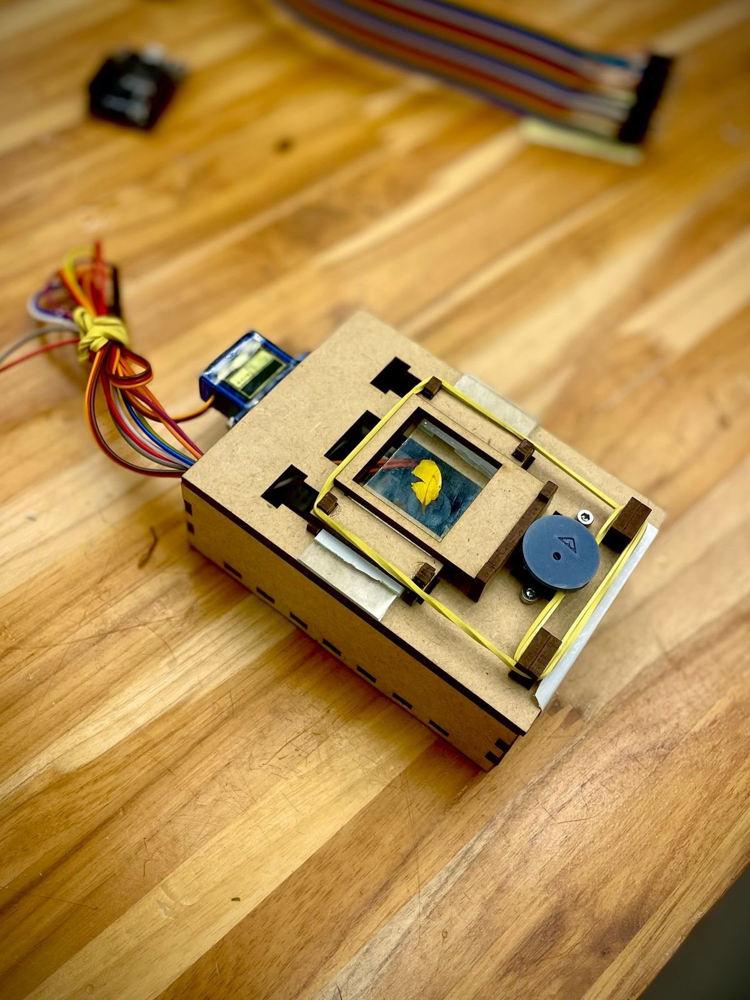
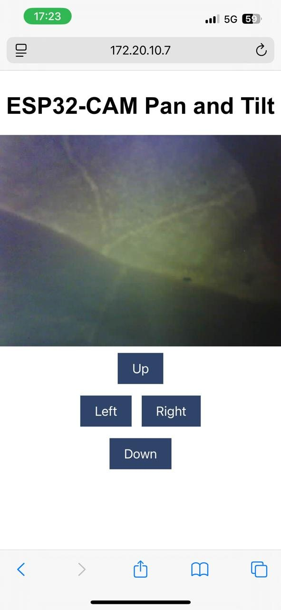
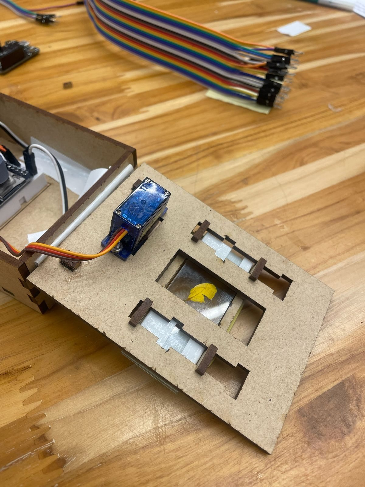
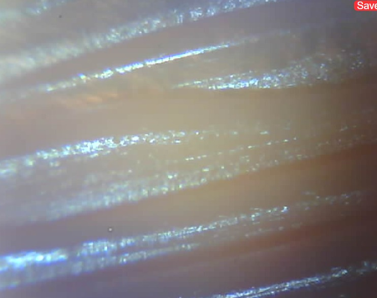
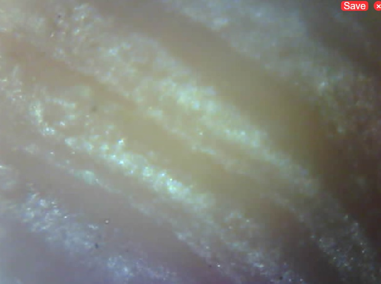

# Microscópio automatizado V1

**Estrutura cortada a laser com ESP32-CAM, dois microservos e controle pelo navegador**

Protótipo montado no bootcamp.

[← Todos os projetos](../README.md)

---

## 📖 Visão geral

A ESP32-CAM observa a amostra e serve, na rede local, uma página com o vídeo e quatro botões. Os botões comandam dois microservos.

### 🧪 Como é usado

1. A placa conecta ao Wi-Fi e mostra o endereço no Monitor Serial.
2. No navegador, a página exibe o vídeo da câmera.
3. Os botões **Up/Down** e **Left/Right** movem os servos.

Captura feita durante o bootcamp, com uma versão anterior do firmware.

### 📊 Recursos do firmware

| Recurso | Como funciona |
| --- | --- |
| Vídeo | Fluxo MJPEG na porta 81 |
| Controle | Página na porta 80, passos de 10 graus, comandos entre 0 e 180 |
| Rede | Wi-Fi da própria instalação, configurado em `secrets.h` |

### ⚠️ Limitações conhecidas

- **Possível conflito entre servos e câmera, não testado em placa:** com ESP32Servo 3.2.0, os servos recebem os canais PWM 0 e 1 (timer 0), e depois o sketch configura a câmera no canal 0 e no timer 0. Os servos podem não se mover corretamente.
- A página, o vídeo e os comandos **não têm autenticação**: qualquer aparelho com acesso à mesma rede pode ver a imagem e mover os servos. Use apenas em rede confiável e não exponha à internet.
- Se a câmera não iniciar, o sketch encerra a inicialização antes de ligar o Wi-Fi; o erro aparece só no Monitor Serial.
- O sketch desativa o detector de queda de tensão (*brownout*) da ESP32.
- O curso mecânico seguro dos servos nesta montagem não está documentado.
- Sem sequência de montagem, ajuste óptico ou calibração.

---

## 🛠️ Ferramentas e processos

| Etapa | Ferramenta | Observação |
| --- | --- | --- |
| Desenho das peças | Inkscape | Registrado nos metadados do SVG |
| Estrutura | Corte a laser em MDF | Conforme o nome do desenho; parâmetros não registrados |
| Firmware | Arduino IDE | Um sketch |

---

## 🧾 Lista de materiais

| Item | Qtd. | Especificação | Origem da informação |
| --- | :---: | --- | --- |
| Chapa de MDF | 1 | 3 mm | Lista original |
| ESP32-CAM | 1 | AI Thinker | Lista original; placa confirmada pelo mantenedor |
| Microservo | 2 | Tower Pro SG90, 9 g | Lista original |
| Jumpers | 10 | — | Lista original |
| Mini protoboard | 1 | — | Lista original |
| Fonte | 1 | 5 V | Lista original |
| Lâminas de vidro | 2 | — | Lista original |
| Capacitor | 1 | 470 µF | Lista original |
| Parafusos | 4 | M2,5 × 10 mm | Lista original |
| Porcas | 4 | M2,5 | Lista original |
| Suporte da lente e discos cinza | — | Material e fabricação não registrados | Vistos nas fotos, **a confirmar** |
| Elásticos | — | — | Vistos nas fotos, **a confirmar** |
| Conector de alimentação | — | Modelo não registrado | Visto nas fotos, **a confirmar** |
| Suporte de bateria usado em bancada | — | Não se sabe se faz parte da montagem final | Visto nas fotos, **a confirmar** |

---

## 🔧 Hardware

Confirmado pelo mantenedor deste fork em 26/11/2026:

| Item | Configuração |
| --- | --- |
| Placa | ESP32-CAM AI Thinker (`CAMERA_MODEL_AI_THINKER`) |
| Servo 1 (botões Up e Down) | GPIO 14 |
| Servo 2 (botões Left e Right) | GPIO 15 |

Não há esquema elétrico; a posição do capacitor e a alimentação dos servos não estão documentadas.

| Eletrônica | Tampa aberta | Teste de bancada |
| --- | --- | --- |
|  |  |  |

---

## 💻 Firmware

[Microscopio_Bootcamp_V1.ino](Microscopio_Bootcamp_V1/Microscopio_Bootcamp_V1.ino), versão **1.0.3** ([changelog](../CHANGELOG.md)).

| Biblioteca ou pacote | Versão usada na compilação |
| --- | --- |
| Pacote de placas `esp32` (Espressif Systems) | 3.3.8 |
| ESP32Servo | 3.2.0 |

Não são necessariamente as versões originais.

---

## 🧰 Como reproduzir na Arduino IDE

1. Instale o pacote de placas **esp32** (Espressif Systems) e escolha **AI Thinker ESP32-CAM**.
2. Pelo Gerenciador de Bibliotecas, instale **ESP32Servo**.
3. Abra `Microscopio_Bootcamp_V1/Microscopio_Bootcamp_V1.ino`.
4. Copie `secrets.h.example` para `secrets.h`, na mesma pasta, e preencha a cópia local.
5. Compile e carregue. A gravação depende do adaptador. Em adaptadores USB-serial sem reset automático, ligue **GPIO 0 ao GND**, reinicie a placa e carregue; depois, **desfaça a ligação** e reinicie.
6. Abra o Monitor Serial em 115200 baud. Quando o Wi-Fi conectar, abra no navegador o endereço `http://` mostrado.

## 🚦 Status

| Verificação | Situação |
| --- | --- |
| Compilação (26/11/2026, arduino-cli) | Feita |
| Teste em placa da versão 1.0.3 | **Não feito** |
| Servos com a câmera ativa | **A verificar** |
| Resolução óptica | **Não medida** |

**Próximos passos:** testar os servos com a câmera ativa e, se o conflito se confirmar, reservar outro timer para eles; registrar esquema, montagem e ajuste óptico; medir o curso seguro dos servos.

---

## 📷 Fotos e imagens obtidas

| Mosquito | PLA impresso | Impressão digital |
| --- | --- | --- |
|  |  |  |

As legendas das imagens ampliadas seguem os nomes dos arquivos. Elas têm um botão "Save" sobreposto; as condições de aquisição não estão registradas, e elas não medem resolução óptica.

## 🗂️ Arquivos

| Arquivo | Conteúdo |
| --- | --- |
| [Sketch](Microscopio_Bootcamp_V1/Microscopio_Bootcamp_V1.ino) | Firmware 1.0.3: câmera, página HTTP e servos |
| [secrets.h.example](Microscopio_Bootcamp_V1/secrets.h.example) | Modelo de configuração local |
| [Microscope_LaserCuts_V01.svg](Microscope_LaserCuts_V01.svg) | Desenho de corte a laser |

## 👥 Créditos

- O sketch preserva o aviso de **Rui Santos & Sara Santos, [Random Nerd Tutorials](https://RandomNerdTutorials.com/esp32-cam-projects-ebook/)**; mantenha-o em cópias.
- Projeto do bootcamp do [FabLab Casa Firjan](https://github.com/fablabcasafirjan/Open_Hardware). Fotos em `fotos/`: acervo do bootcamp, de pasta compartilhada por Willian.

## 📄 Licença

MIT, a mesma do repositório original ([LICENSE](../LICENSE)). O aviso de terceiros no sketch é mantido. Veja [créditos](../README.md#créditos) e [licenças](../README.md#licenças).

## English summary

Educational microscope with an AI Thinker ESP32-CAM, two SG90 servos and a laser-cut structure. The board serves an unauthenticated local web page with video and servo controls. The sketch compiles but this version was not tested on hardware.
