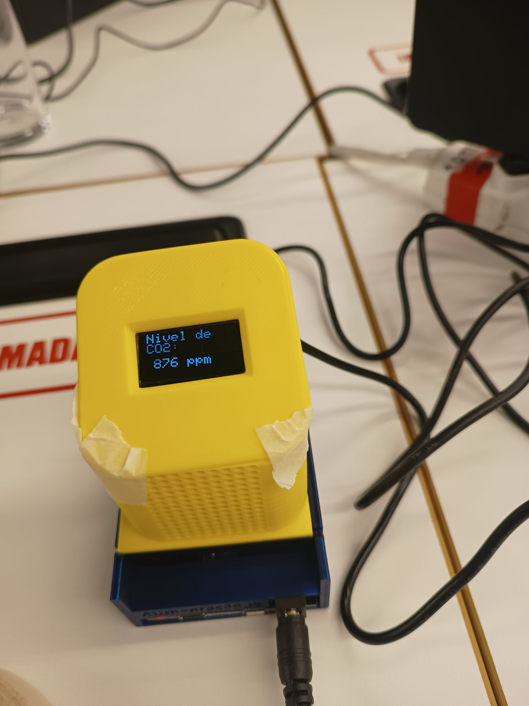
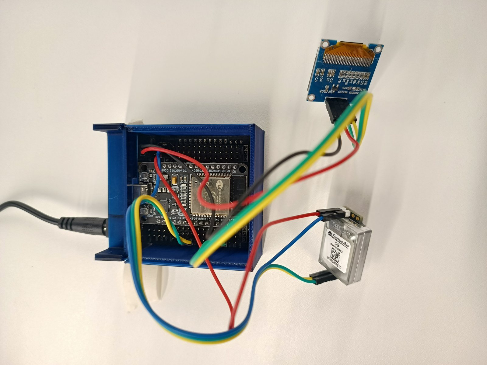
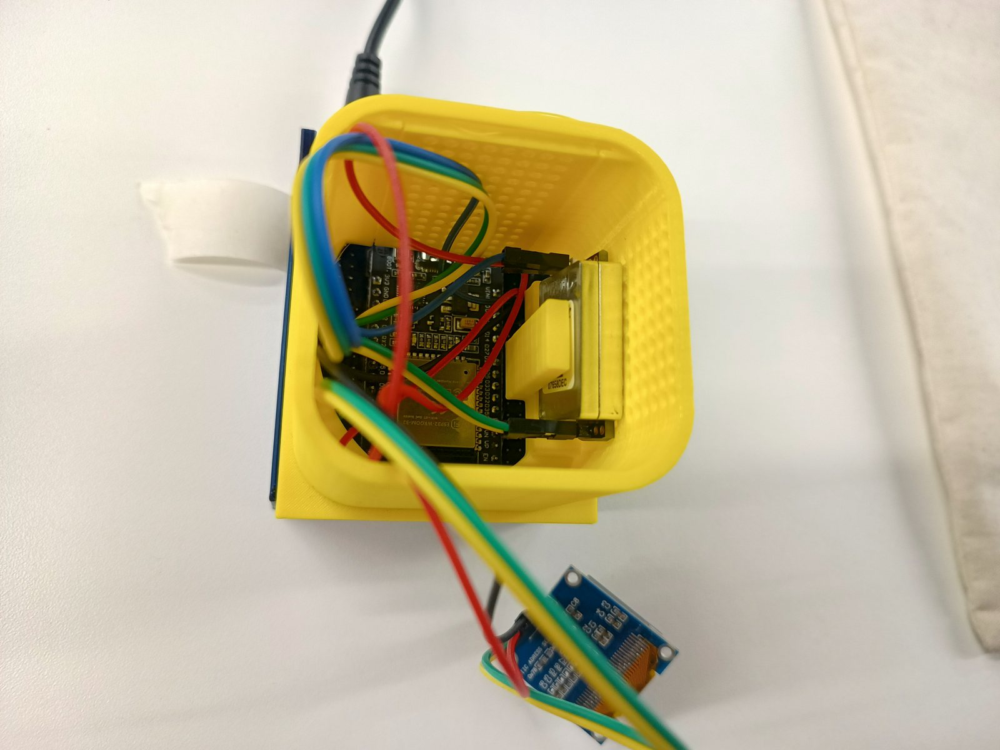
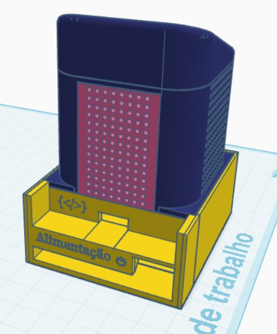

# Medidor de CO₂

**Leitura de CO₂ com sensor SenseAir S8, ESP32 e display OLED, com envio opcional ao Telegram**

Protótipo montado no bootcamp. A leitura na tela é um registro visual, sem comparação com uma referência.

[← Todos os projetos](../README.md)

---

## 📖 Visão geral

O sensor SenseAir S8 mede a concentração de CO₂, o ESP32 lê o valor pela serial e o mostra em ppm no OLED e no Monitor Serial. Com Wi-Fi, o equipamento também envia a leitura a um chat do Telegram.

### 🧪 Como funciona

1. Ao ligar, o display mostra **"Tentando conectar ao WiFi"** com uma contagem de **10 até 0** segundos.
2. Se conectar, a contagem termina antes, e o equipamento envia a mensagem "ESP32 conectado e pronto!".
3. Se não conectar em 10 segundos, ele **segue para a medição offline**.
4. A leitura é atualizada no display cerca de duas vezes por segundo. Com Wi-Fi, uma mensagem é enviada a cada 30 segundos.

Há **um único firmware**. As leituras **não são armazenadas**: o que não é enviado se perde. No modo offline, o sketch não desliga o Wi-Fi; se a conexão acontecer depois, os envios passam a ocorrer. Esse comportamento não foi testado em placa.

### 📊 O que o protótipo entrega

| Informação | Onde aparece | Precisa de Wi-Fi? |
| --- | --- | :---: |
| CO₂ em ppm | Display OLED | Não |
| CO₂ em ppm | Monitor Serial (115200 baud) | Não |
| Mensagem com a leitura | Chat do Telegram, a cada 30 s | Sim |

### ⚠️ Limitações conhecidas

- Leituras não aferidas contra uma referência.
- Se o S8 ou o OLED não responderem na inicialização, o sketch para até a placa ser reiniciada. Falhas durante a medição não são tratadas.
- O envio ao Telegram acontece dentro do ciclo de medição e pode atrasar a atualização do display.
- **A conexão com o Telegram não valida o certificado do servidor.** No core `esp32` 3.3.8, `http.begin(url)` sem certificado desativa essa verificação. Quem conseguir interceptar o tráfego pode obter o token do bot; use apenas em rede confiável e com um bot exclusivo para este protótipo.
- O nome da rede é impresso no Monitor Serial. `secrets.h` fica em texto puro no computador, e os valores são gravados na placa.

---

## 🛠️ Ferramentas e processos

| Etapa | Ferramenta | Observação |
| --- | --- | --- |
| Caixa | Impressão 3D em PLA | Material da lista original. Arquivos STL nesta pasta. |
| Modelo 3D | A confirmar | As capturas abaixo mostram o modelo em um editor 3D. |
| Firmware | Arduino IDE | Um sketch. |

---

## 🧾 Lista de materiais

| Item | Qtd. | Especificação | Origem da informação |
| --- | :---: | --- | --- |
| Sensor de CO₂ | 1 | SenseAir S8, comunicação serial a 9600 baud | Lista original, sketch e fotos |
| Microcontrolador | 1 | ESP32 Wroom 32 DevKit V1 | Lista original; placa confirmada pelo mantenedor |
| Display OLED I²C | 1 | 128 × 64, endereço `0x3C` (a lista original diz 0,92") | Lista original; endereço confirmado pelo mantenedor |
| Fonte | 1 | 5 V | Lista original |
| Filamento | — | PLA | Lista original |
| Peças da caixa | 1 conjunto | STL V02 ou V03 (combinação a definir) | Arquivos do repositório |
| Placa de apoio para o ESP32 | 1 | Modelo não identificado | Vista nas fotos, **a confirmar** |
| Jumpers | — | Quantidade não registrada | Vistos nas fotos, **a confirmar** |
| Plugue e cabo de alimentação | 1 | Conector cilíndrico; medidas não registradas | Vistos nas fotos, **a confirmar** |

---

## 🔧 Hardware

Ligações confirmadas pelo mantenedor deste fork em 26/11/2026:

| Sinal | ESP32 |
| --- | --- |
| TX do SenseAir S8 | GPIO 16 (RX) |
| RX do SenseAir S8 | GPIO 17 (TX) |
| OLED | I²C, endereço `0x3C`, nos pinos I²C padrão da placa (o sketch não os redefine) |

Isso não é um esquema elétrico completo: alimentação e níveis de tensão não estão documentados.

| Eletrônica | Interior da caixa |
| --- | --- |
|  |  |

---

## 💻 Firmware

[Sensor_CO2_comDisplay_comTelegram.ino](Sensor_CO2_comDisplay_comTelegram/Sensor_CO2_comDisplay_comTelegram.ino), versão **1.1.0** ([changelog](../CHANGELOG.md)).

| Biblioteca ou pacote | Versão usada na compilação |
| --- | --- |
| Pacote de placas `esp32` (Espressif Systems) | 3.3.8 |
| EspSoftwareSerial (Dirk Kaar, Peter Lerup) | 8.1.0 (também registrada no sketch) |
| [S8_UART](https://github.com/jcomas/S8_UART/tree/v1.0.2) (Josep Comas) | 1.0.2 (também registrada no sketch) |
| Adafruit GFX Library | 1.12.6 |
| Adafruit SSD1306 | 2.5.16 |
| Adafruit BusIO | 1.17.4 |

---

## 🧰 Como reproduzir na Arduino IDE

1. Instale o pacote de placas **esp32** (Espressif Systems) e escolha **ESP32 Dev Module**.
2. Pelo Gerenciador de Bibliotecas, instale **EspSoftwareSerial 8.1.0**, **Adafruit GFX Library** e **Adafruit SSD1306** (com a dependência Adafruit BusIO).
3. Instale a **S8_UART 1.0.2**: baixe o ZIP da tag `v1.0.2` em [jcomas/S8_UART](https://github.com/jcomas/S8_UART/tree/v1.0.2) e use **Sketch > Incluir Biblioteca > Adicionar biblioteca .ZIP**.
4. Abra o `.ino`. Na pasta dele, copie `secrets.h.example` para `secrets.h` e preencha a cópia local com a rede, o token do bot e o ID do chat. O arquivo é necessário para compilar, mesmo que o uso seja offline.
5. Compile, carregue e abra o Monitor Serial em 115200 baud.

## 🚦 Status

| Verificação | Situação |
| --- | --- |
| Compilação (26/11/2026, arduino-cli) | Feita, com os valores de exemplo |
| Teste em placa da versão 1.1.0 | **Não feito** |
| Envio ao Telegram | **Não testado** |
| Aferição das leituras | **Não feita** |

**Próximos passos:** testar a contagem e o modo offline em placa, comparar as leituras com uma referência, registrar o esquema elétrico e definir as peças finais da caixa.

---

## 📷 Fotos e modelo 3D

| Montado, vista lateral | Peças da tampa |
| --- | --- |
|  |  |

Capturas do modelo 3D:

| Frente | Verso |
| --- | --- |
|  |  |

## 🗂️ Arquivos

| Arquivo | Conteúdo |
| --- | --- |
| [Sketch](Sensor_CO2_comDisplay_comTelegram/Sensor_CO2_comDisplay_comTelegram.ino) | Firmware 1.1.0 |
| [secrets.h.example](Sensor_CO2_comDisplay_comTelegram/secrets.h.example) | Modelo de configuração local |
| [V02: corpo](Case%20Sensor%20CO2%20V02%20Bootcamp%20Corpo.stl), [tampa do corpo](Case%20Sensor%20CO2%20V02%20Bootcamp%20Tampa%20Corpo.stl), [topo](Case%20Sensor%20CO2%20V02%20Bootcamp%20Topo.stl) | STL da caixa V02 |
| [V03: base, frente](Case%20Sensor%20CO2%20V03%20Bootcamp%20Base%20frente.stl), [base, trás](Case%20Sensor%20CO2%20V03%20Bootcamp%20Base%20tras.stl) | STL da base V03 |

## 👥 Créditos

- Sketch de **Ricardo Michel** (15/07/2025), baseado no exemplo "Get CO2 value" da biblioteca [S8_UART](https://github.com/jcomas/S8_UART) (MIT), de **Josep Comas**.
- A parte superior da caixa é um remix de [CO2 Weather station - case for Wemos, SSD1306, Senseair S8, MH-Z19](https://www.thingiverse.com/thing:5382369), de **localhorst_**, licenciado sob [CC BY 4.0](https://creativecommons.org/licenses/by/4.0/) (página consultada em 26/11/2026).
- Fotos em `fotos/`: acervo do bootcamp, de pasta compartilhada por Willian.
- Projeto do bootcamp do [FabLab Casa Firjan](https://github.com/fablabcasafirjan/Open_Hardware).

## 📄 Licença

MIT, a mesma do repositório original ([LICENSE](../LICENSE)). Materiais de terceiros, como o remix acima, mantêm as próprias condições. Veja [créditos](../README.md#créditos) e [licenças](../README.md#licenças).

## English summary

CO₂ meter with a SenseAir S8, an ESP32 and a 128×64 OLED. On boot, it shows a 10-second Wi-Fi countdown and then measures even without a network; readings are not stored. Single Arduino sketch. It compiles; version 1.1.0 was not tested on hardware. The upper part of the case is a remix of a CC BY 4.0 design by localhorst_.
