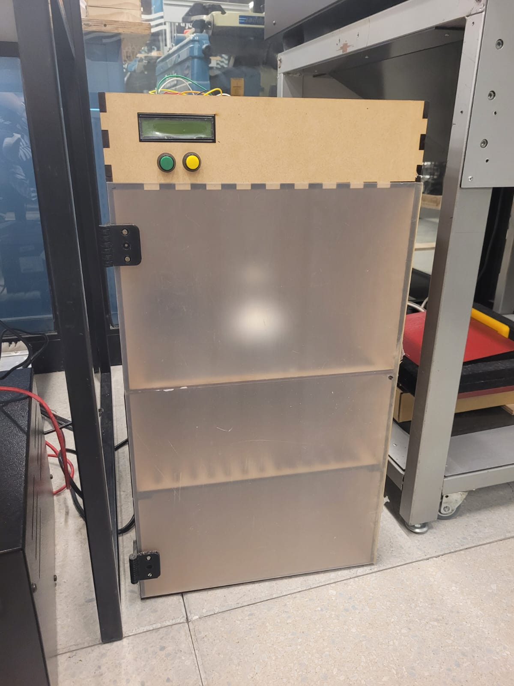

# Incubadora (também serve de estufa)

**Câmara aquecida didática em MDF e acrílico, com Arduino UNO e sensor DS18B20**

Protótipo montado no bootcamp. A foto não é um ensaio térmico.

[← Todos os projetos](../README.md)

> [!WARNING]
> **Não ligue a lâmpada à rede sem uma proteção térmica independente e sem validar o circuito. Não deixe o equipamento ligado sem supervisão.** Este aviso não substitui essas proteções. O equipamento usa uma lâmpada de 250 W na rede elétrica, e a segurança não foi validada. Pela leitura do código:
> - o sketch trata `LOW` como lâmpada ligada, e o pino do relé começa em `LOW` ao energizar;
> - com o DS18B20 desconectado, a biblioteca retorna -127 °C, e o sketch **liga ou mantém ligada** a lâmpada;
> - não há limite máximo para a temperatura alvo nem desligamento de proteção.
>
> Os próprios comentários do código pedem para conferir a polaridade do relé no circuito real. A montagem na rede elétrica deve ser feita por pessoa habilitada.

---

## 📖 Visão geral

A câmara tem uma lâmpada de aquecimento, um ventilador, um sensor de temperatura, um LCD e dois botões. Serve como incubadora e também como estufa.

### 🧪 Como funciona

1. O DS18B20 mede a temperatura, e o LCD mostra a leitura e o valor alvo.
2. Os botões diminuem ou aumentam o alvo em passos de 0,5 °C.
3. O sketch liga a lâmpada abaixo de `alvo − 0,5 °C` e a desliga ao atingir o alvo (controle liga/desliga com histerese).
4. O ventilador fica em PWM 255 ao aquecer e passa a 122 quando a lâmpada é desligada.

### 📊 Entradas e saídas

| Função | Componente | Firmware |
| --- | --- | --- |
| Temperatura | DS18B20 | Leitura em 12 bits |
| Ajuste do alvo | Dois botões | Inicial: 37,5 °C |
| Exibição | LCD 16 × 2 e Monitor Serial (9600 baud) | Temperatura e alvo |
| Aquecimento | Lâmpada de 250 W via relé de estado sólido | Liga/desliga |
| Circulação de ar | Ventilador | PWM |

### ⚠️ Limitações conhecidas

- Os pontos de segurança do aviso acima.
- Botões sem tratamento de repique (*debounce*).
- O LCD não limpa os caracteres que sobram quando o número exibido fica mais curto.
- Sem ensaio documentado de estabilidade, uniformidade ou faixa de temperatura.
- Sem esquema elétrico nem sequência de montagem.

### 🛡️ Sugestões de segurança (ainda não implementadas)

São recomendações para revisar antes de usar o equipamento. O firmware não as aplica, porque a polaridade do relé precisa ser confirmada no circuito real.

- Garantir que o relé fique **desligado** ao energizar e durante a reinicialização da placa, no firmware e no circuito.
- Desligar a lâmpada e sinalizar o erro quando a leitura do sensor for inválida (por exemplo, -127 °C) ou estiver fora de uma faixa plausível.
- Limitar a temperatura alvo a um mínimo e um máximo definidos em ensaio.
- Instalar uma proteção térmica **independente do Arduino** (termostato de segurança ou fusível térmico), pois um relé de estado sólido pode falhar fechado.
- Prever fusível, aterramento, isolamento das partes ligadas à rede e distância entre a lâmpada e materiais inflamáveis, como o MDF.

---

## 🛠️ Ferramentas e processos

| Etapa | Ferramenta | Observação |
| --- | --- | --- |
| Desenho das peças | Inkscape | Registrado nos metadados do SVG |
| Estrutura | Peças de MDF e acrílico | Desenho no SVG; parâmetros de corte não registrados |
| Dobradiças | Impressão 3D em PLA | Lista original |
| Firmware | Arduino IDE | Um sketch |

---

## 🧾 Lista de materiais

| Item | Qtd. | Especificação | Origem da informação |
| --- | :---: | --- | --- |
| Chapa de MDF | 1 | 6 mm | Lista original |
| Chapa de MDF | 1 | 3 mm | Lista original |
| Chapa de acrílico | 1 | 3 mm | Lista original |
| Arduino UNO | 1 | — | Lista original |
| Sensor de temperatura | 1 | DS18B20 | Lista original |
| LCD | 1 | 16 × 2 | Lista original |
| Trimpot | 1 | 10 kΩ | Lista original |
| Botões | 2 | Amarelo e azul nas fotos | Lista original e fotos |
| Lâmpada de aquecimento | 1 | 250 W | Lista original |
| Relé de estado sólido | 1 | Modelo não registrado | Lista original |
| Ventilador | 1 | 12 V, 8 × 8 cm | Lista original |
| Fonte | 1 | 7 V | Lista original. Como o ventilador listado é de 12 V, a alimentação está **a confirmar** |
| Extensão com tomada | 1 | — | Lista original |
| Protoboard | 1 | — | Lista original |
| Jumpers | — | Quantidade não registrada | Lista original |
| Dobradiças | 2 | PLA impresso em 3D | Lista original |
| Parafusos | 2 | M2 × 12 mm | Lista original |
| Folha de alumínio | 1 | — | Lista original |
| Soquete da lâmpada e módulo com bornes | — | Modelos não identificados | Vistos nas fotos, **a confirmar** |

---

## 🔧 Hardware

Pinos confirmados pelo mantenedor deste fork em 26/11/2026:

| Sinal | Pino do Arduino UNO |
| --- | --- |
| DS18B20 (dados) | 8 |
| LCD RS, EN | 12, 11 |
| LCD D4, D5, D6, D7 | 5, 4, 3, 2 |
| Relé da lâmpada | 6 |
| Ventilador (PWM) | 10 |
| Botão que diminui a temperatura alvo | 9 (`INPUT_PULLUP`) |
| Botão que aumenta a temperatura alvo | 13 (`INPUT_PULLUP`) |

A tabela não é um esquema elétrico: alimentação, acionamento do ventilador, resistores e ligação de potência não estão documentados.

| Compartimento superior | Fiação |
| --- | --- |
|  |  |

---

## 💻 Firmware

[Incubator_Bootcamp_V1.ino](Incubator_Bootcamp_V1/Incubator_Bootcamp_V1.ino), versão **1.0.1** ([changelog](../CHANGELOG.md)). O comentário do código o chama de "Incubadora V03".

| Biblioteca ou pacote | Versão usada na compilação |
| --- | --- |
| Pacote de placas `arduino:avr` | 1.8.7 |
| LiquidCrystal | 1.0.7 |
| OneWire | 2.3.8 |
| DallasTemperature | 4.0.6 |

Não são necessariamente as versões da montagem original.

---

## 🧰 Como reproduzir na Arduino IDE

1. Abra `Incubator_Bootcamp_V1/Incubator_Bootcamp_V1.ino`.
2. Em **Ferramentas > Placa**, escolha **Arduino Uno**.
3. Pelo Gerenciador de Bibliotecas, instale `LiquidCrystal`, `OneWire` e `DallasTemperature`.
4. Use **Verificar** para compilar.
5. Antes de carregar, leia o aviso acima e confira o circuito. Faça os primeiros testes de lógica com a lâmpada desconectada da rede.
6. No Monitor Serial, use 9600 baud. Os botões são lidos uma vez por ciclo, e a leitura do sensor em 12 bits leva cerca de 0,75 s; mantenha o botão pressionado até o valor mudar.
7. O botão de aumentar usa o pino 13, ligado ao LED da própria placa. Em algumas placas, isso pode fazer o pino ler `LOW` com o botão solto. Confira se a temperatura alvo não sobe sozinha.

## 🚦 Status

| Verificação | Situação |
| --- | --- |
| Compilação (26/11/2026, arduino-cli) | Feita |
| Teste em placa desta versão | **Não feito** |
| Ensaio térmico documentado | **Não há** |
| Segurança elétrica e térmica | **Não validada** |

**Próximos passos:** registrar o esquema elétrico e o modelo do relé; confirmar a polaridade; revisar estado inicial, falha do sensor e limites; documentar a montagem e um ensaio térmico.

---

## 📷 Fotos

| LCD e botões | Lâmpada |
| --- | --- |
|  |  |

O LCD da foto mostra um alvo de 60 °C. O firmware não impõe limite máximo.

| Fechada | Aberta | Ligada |
| --- | --- | --- |
|  |  |  |

## 🗂️ Arquivos

| Arquivo | Conteúdo |
| --- | --- |
| [Sketch](Incubator_Bootcamp_V1/Incubator_Bootcamp_V1.ino) | Firmware 1.0.1 |
| [Incubadora_V06_Organizado.svg](Incubadora_V06_Organizado.svg) | Desenho das peças da caixa |

## 👥 Créditos

Projeto do bootcamp do [FabLab Casa Firjan](https://github.com/fablabcasafirjan/Open_Hardware). Fotos em `fotos/`: acervo do bootcamp, de pasta compartilhada por Willian.

## 📄 Licença

MIT, a mesma do repositório original ([LICENSE](../LICENSE)). Veja [créditos](../README.md#créditos) e [licenças](../README.md#licenças).

## English summary

Educational incubator, also used as a warm lab cabinet: Arduino UNO, DS18B20, LCD, 250 W heat lamp and fan. The sketch compiles but this version was not tested on hardware. **Do not leave it unattended:** thermal safety is not validated, and a disconnected sensor turns the lamp on or keeps it on.
