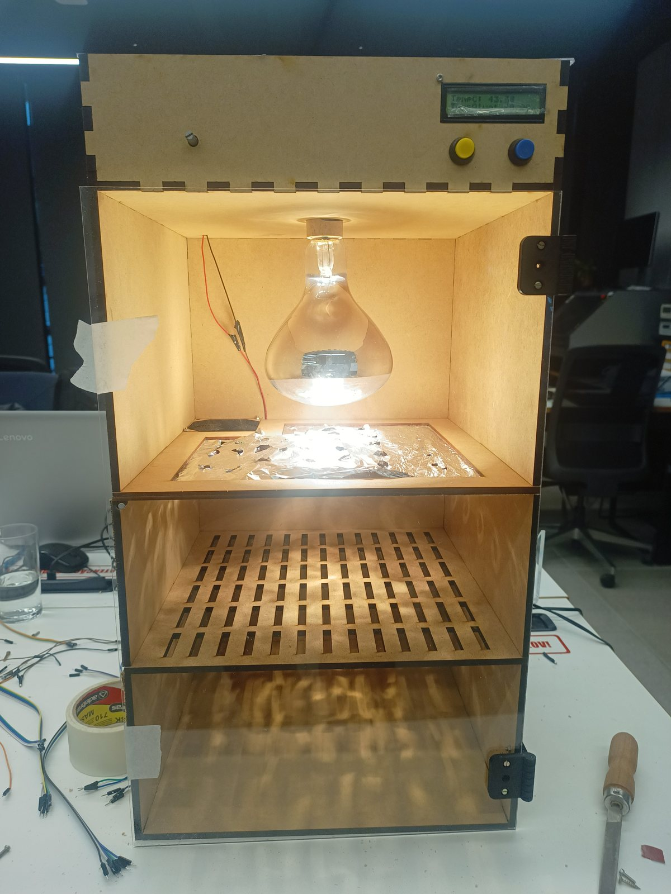
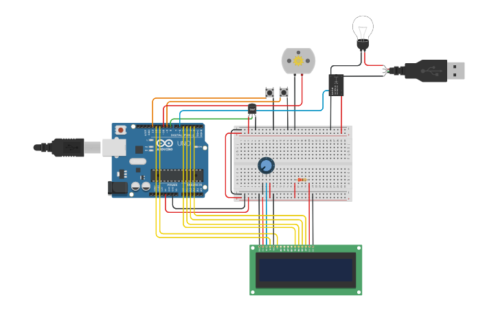
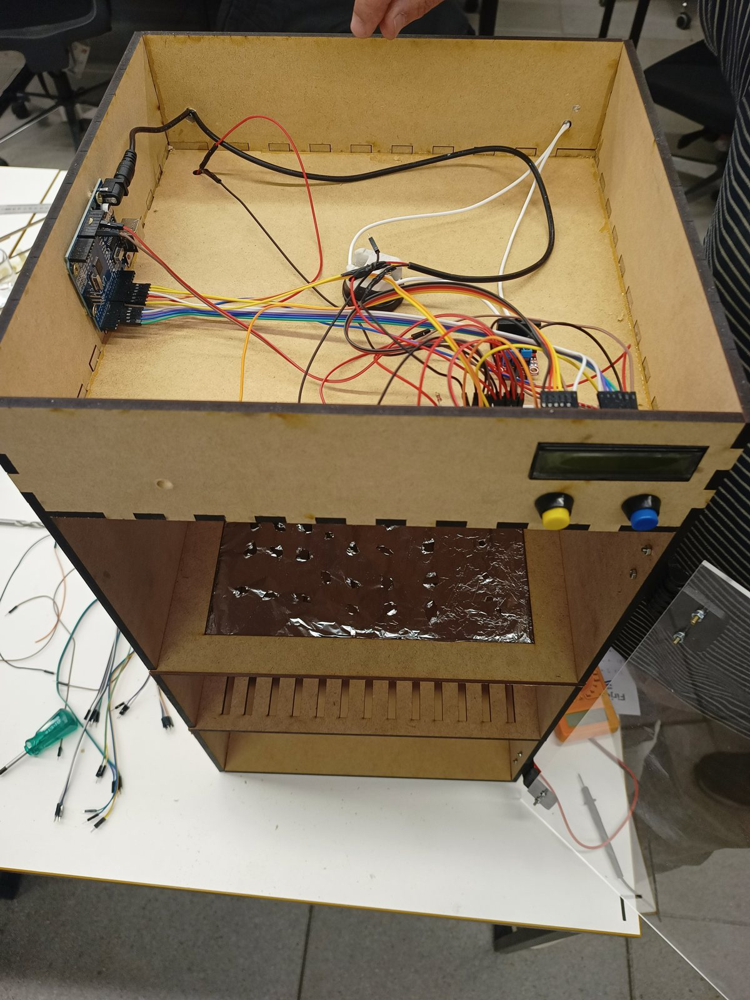
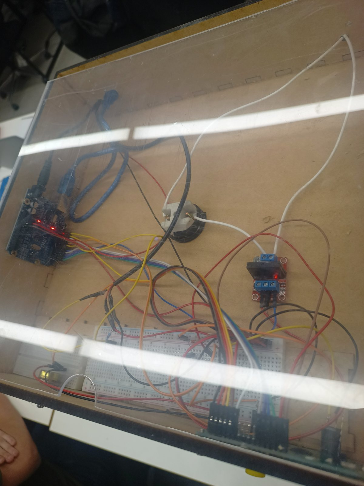
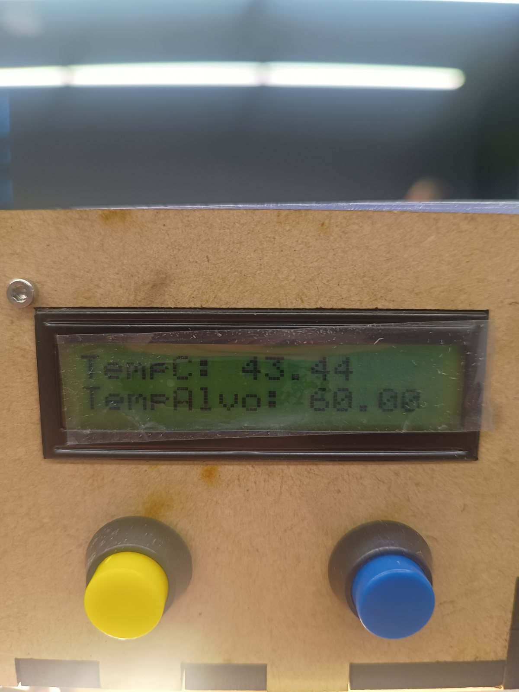
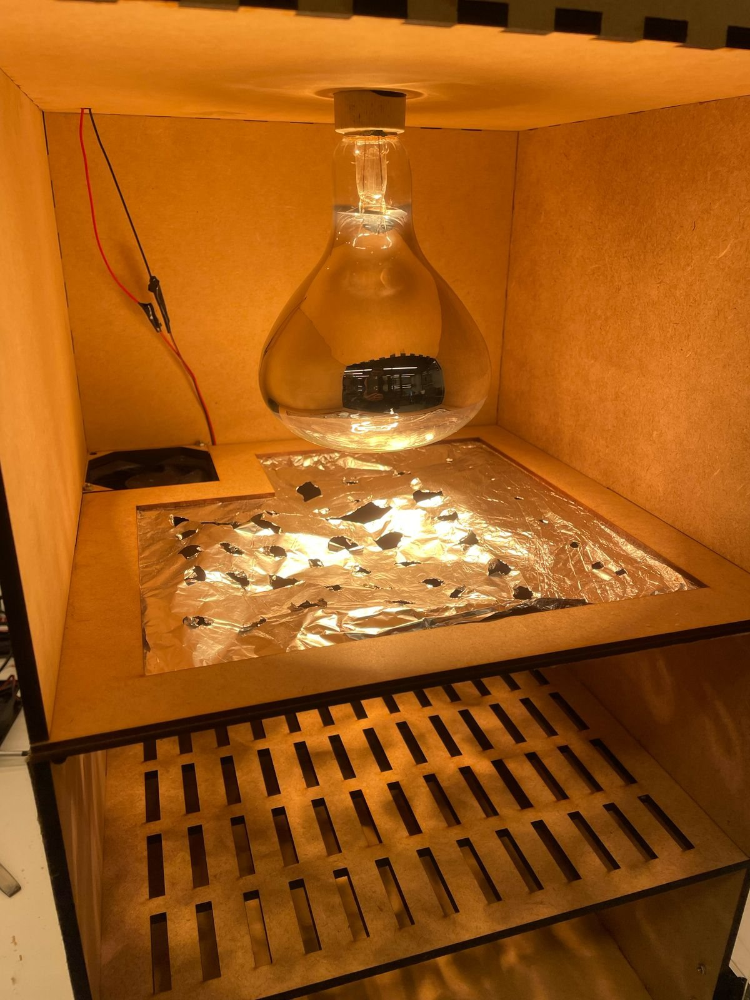
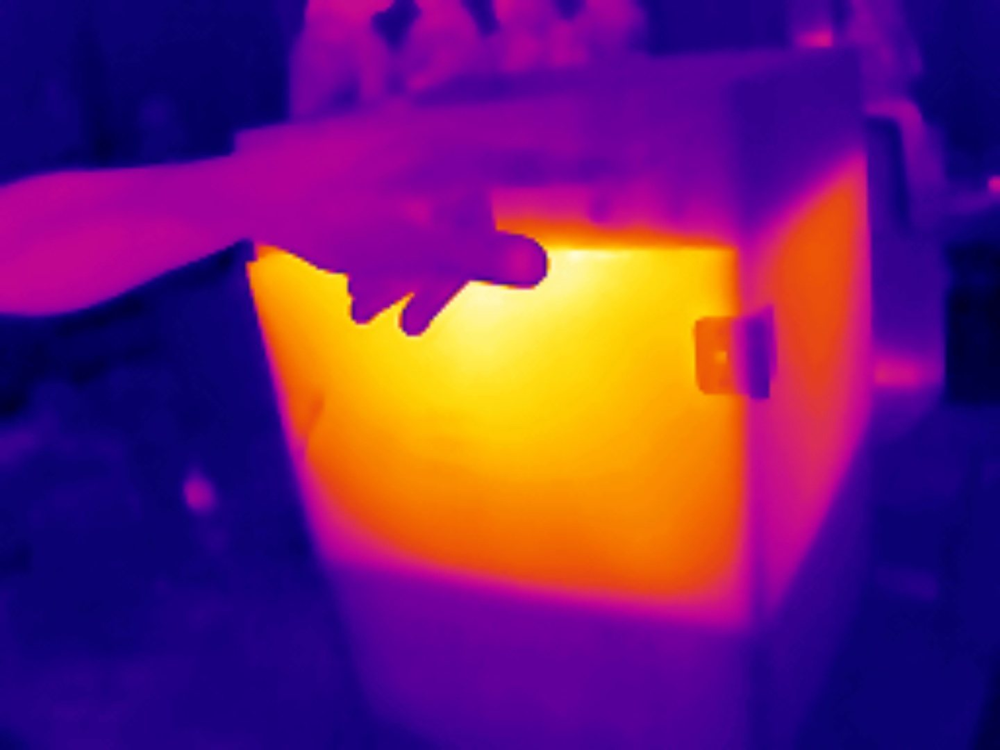
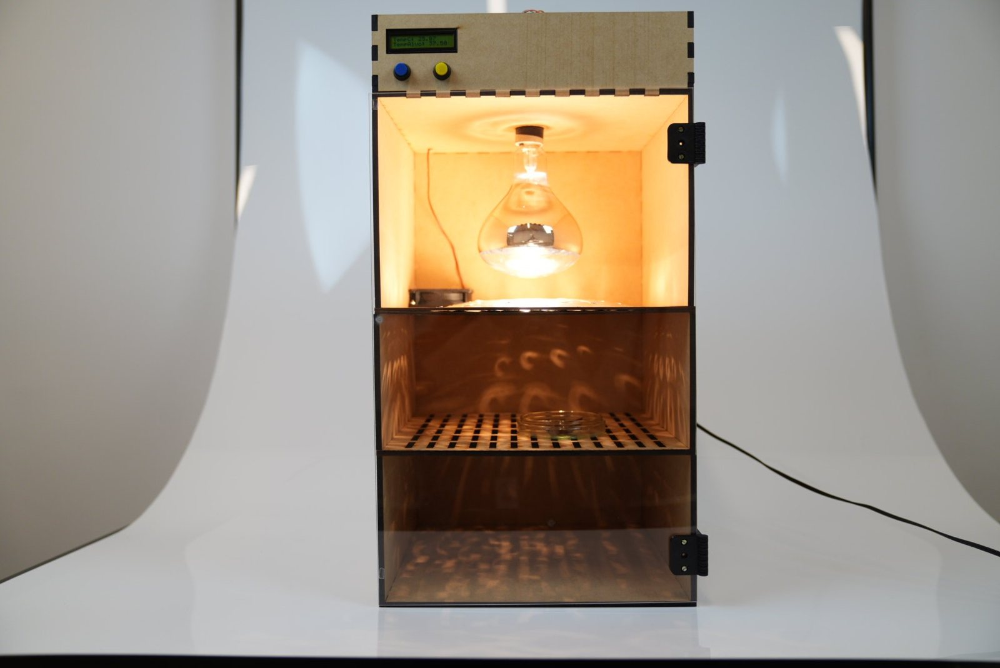
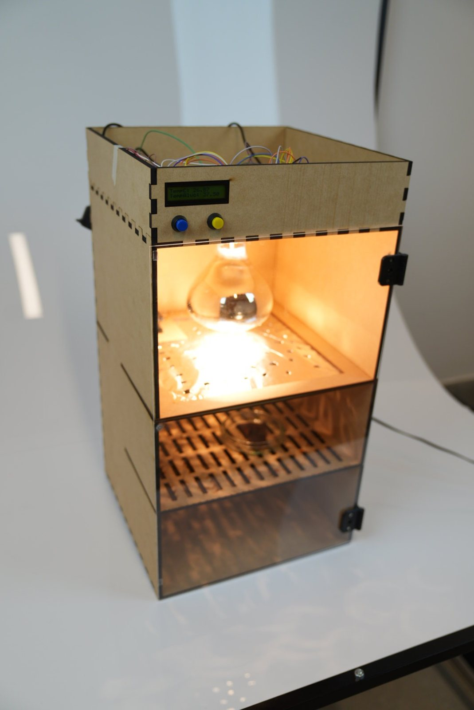

# Incubadora/Estufa V1

**Câmara aquecida didática em MDF e acrílico, com Arduino UNO e sensor DS18B20**

Protótipo montado no bootcamp. A foto não é um ensaio térmico.

[← Todos os projetos](../README.md)

> [!WARNING]
> **O equipamento usa uma lâmpada de 250 W na rede elétrica, e a segurança não foi validada. Não ligue a lâmpada à rede sem uma proteção térmica independente e sem validar o circuito. Não deixe o equipamento ligado sem supervisão.** A montagem na rede elétrica deve ser feita por pessoa habilitada.
>
> **Antes da primeira ligação, com a lâmpada fora da rede, confira a polaridade do relé.** O sketch considera que o relé liga com `LOW` e desliga com `HIGH`. Há relés que funcionam ao contrário: nesse caso, a lâmpada ligaria justamente quando deveria desligar. Se for o seu, inverta `RELE_LIGADO` e `RELE_DESLIGADO` no sketch. Entre a energização e o início do programa, o estado do relé depende só do circuito.

---

## 📖 Visão geral

A câmara tem uma lâmpada de aquecimento, um ventilador, um sensor de temperatura, um LCD e dois botões.

### 🧪 Como funciona

1. Ao iniciar, o relé é colocado em `HIGH` (lâmpada desligada).
2. O DS18B20 mede a temperatura, e o LCD mostra a leitura e o valor alvo.
3. Os botões, com *debounce*, mudam o alvo em passos de 0,5 °C; mantidos pressionados, repetem. O alvo vai até **60 °C**.
4. O sketch liga a lâmpada abaixo de `alvo − 0,5 °C` e a desliga ao atingir o alvo (controle liga/desliga com histerese).
5. O ventilador fica em PWM 255 ao aquecer e passa a 122 quando a lâmpada é desligada.
6. Se o DS18B20 for desconectado ou a leitura for inválida, a lâmpada é desligada, o ventilador vai a 255 e o LCD mostra **ERRO NO SENSOR**. O controle volta quando a leitura volta.

### 📊 Entradas e saídas

| Função | Componente | Firmware |
| --- | --- | --- |
| Temperatura | DS18B20 | Leitura em 12 bits |
| Ajuste do alvo | Dois botões | Inicial: 37,5 °C |
| Exibição | LCD 16 × 2 e Monitor Serial (9600 baud) | Temperatura e alvo |
| Aquecimento | Lâmpada de 250 W via relé de estado sólido | Liga/desliga |
| Circulação de ar | Ventilador | PWM |

### ⚠️ Limitações conhecidas

- Falta o ensaio térmico: estabilidade, uniformidade e faixa de temperatura não foram medidas.
- O esquema publicado é didático e simplificado. Faltam o esquema da ligação real e a sequência de montagem.
- O limite de 60 °C vale para o **alvo**. A temperatura medida pode passar dele, e o limite não é uma proteção térmica.
- A falha detectada é a de leitura ausente ou fora da faixa do sensor. Um sensor mal posicionado ou com leitura errada, mas plausível, não é percebido.

### 🛡️ Sugestões de segurança (ainda não implementadas)

- Instalar uma proteção térmica **independente do Arduino** (termostato de segurança ou fusível térmico), pois um relé de estado sólido pode falhar fechado.
- Prever fusível, aterramento, isolamento das partes ligadas à rede e distância entre a lâmpada e materiais inflamáveis, como o MDF.

---

## 🛠️ Ferramentas e processos

| Etapa | Ferramenta |
| --- | --- |
| Desenho das peças | Inkscape |
| Esquema didático | Tinkercad |
| Corte do MDF e do acrílico | Cortadora a laser CO₂ de 80 W (marca e modelo a confirmar) |
| Dobradiças em PLA | Impressora 3D Bambu Lab A1 |
| Firmware | Arduino IDE |

---

## 🧾 Lista de materiais

| Item | Qtd. | Especificação |
| --- | :---: | --- |
| Chapa de MDF | 1 | 6 mm |
| Chapa de MDF | 1 | 3 mm |
| Chapa de acrílico | 1 | 3 mm |
| Arduino UNO | 1 | — |
| Sensor de temperatura | 1 | DS18B20 |
| LCD | 1 | 16 × 2 |
| Trimpot | 1 | 10 kΩ |
| Botões | 2 | Amarelo e azul nas fotos |
| Lâmpada de aquecimento | 1 | 250 W |
| Relé de estado sólido | 1 | Modelo não registrado |
| Ventilador | 1 | 12 V, 8 × 8 cm |
| Fonte | 1 | 7 V |
| Extensão com tomada | 1 | — |
| Protoboard | 1 | — |
| Jumpers | — | Quantidade não registrada |
| Dobradiças | 2 | PLA impresso em 3D |
| Parafusos | 2 | M2 × 12 mm |
| Folha de alumínio | 1 | — |
| Soquete da lâmpada e módulo com bornes | — | Modelos não registrados |

---

## 🔧 Hardware

Pinos confirmados pelo mantenedor deste fork em 26/11/2026:

| Sinal | Pino do Arduino UNO |
| --- | --- |
| DS18B20 (dados) | 8 |
| LCD RS, EN | 12, 11 |
| LCD D4, D5, D6, D7 | 5, 4, 3, 2 |
| Relé da lâmpada | 6 |
| Ventilador (PWM) | 10 |
| Botão que diminui a temperatura alvo | 9 (`INPUT_PULLUP`) |
| Botão que aumenta a temperatura alvo | 13 (`INPUT_PULLUP`) |

### Esquema didático

Circuito de aula feito no Tinkercad ("Circuito Incubadora V03"). Os pinos do Arduino conferem com a tabela acima.

> [!CAUTION]
> **É um esquema para entender as ligações de sinal. Não monte a parte de potência por ele.**
> - O sensor desenhado (**TMP**) é só um substituto: a montagem usa o **DS18B20**, que normalmente precisa de um resistor de *pull-up* (em geral 4,7 kΩ) entre dados e 5 V. O desenho não mostra esse resistor.
> - O ventilador aparece ligado direto no pino 10. **Um pino do Arduino não alimenta um ventilador de 12 V**: é preciso um circuito de acionamento com alimentação própria.
> - O relé é uma peça genérica do simulador, e o cabo USB representa a tomada. O desenho não define o modelo, a polaridade nem a ligação do relé na rede.

A alimentação, o acionamento real do ventilador e a ligação de potência não estão documentados.

| Compartimento superior | Fiação |
| --- | --- |
|  |  |

---

## 💻 Firmware

[Incubator_Bootcamp_V1.ino](Incubator_Bootcamp_V1/Incubator_Bootcamp_V1.ino), versão **1.0.1** ([changelog](../CHANGELOG.md)).

| Biblioteca ou pacote | Versão usada na compilação |
| --- | --- |
| Pacote de placas `arduino:avr` | 1.8.7 |
| LiquidCrystal | 1.0.7 |
| OneWire | 2.3.8 |
| DallasTemperature | 4.0.6 |

Não são necessariamente as versões da montagem original.

---

## 🧰 Como reproduzir na Arduino IDE

1. Abra `Incubator_Bootcamp_V1/Incubator_Bootcamp_V1.ino`.
2. Em **Ferramentas > Placa**, escolha **Arduino Uno**.
3. Pelo Gerenciador de Bibliotecas, instale `LiquidCrystal`, `OneWire` e `DallasTemperature`.
4. Use **Verificar** para compilar.
5. Com a **lâmpada fora da rede**, carregue o sketch e confira, com um multímetro ou pelo LED do módulo, se o relé fica desligado ao iniciar (aviso no topo).
6. No Monitor Serial, em 9600 baud, confira a leitura. Desconecte o DS18B20: o LCD deve mostrar **ERRO NO SENSOR**, e o relé, ficar desligado.
7. Teste os botões: um toque muda 0,5 °C, e o alvo para em 60 °C.
8. O botão de aumentar usa o pino 13, ligado ao LED da própria placa. Em algumas placas, isso pode fazer o pino ler `LOW` com o botão solto. Confira se a temperatura alvo não sobe sozinha.

## 🚦 Status

| Verificação | Situação |
| --- | --- |
| Compilação (27/11/2026, arduino-cli) | Feita |
| Simulação do firmware 1.0.1 num ATmega328 virtual, sem sensor (27/11/2026) | Relé sempre desligado; botões, *debounce* e limite de 60 °C conferidos |
| Controle com leitura de temperatura válida na versão 1.0.1 | **Não testado** |
| Teste em placa da versão 1.0.1 | **Não feito** |
| Ensaio térmico | **Falta fazer** |
| Segurança elétrica e térmica | **Não validada** |

**Próximos passos:** confirmar a polaridade do relé na montagem, testar a versão 1.0.1 em placa, registrar a ligação real e a sequência de montagem e fazer o ensaio térmico.

---

## 📷 Fotos

| LCD e botões | Lâmpada |
| --- | --- |
|  |  |

A imagem térmica é só um exemplo: não tem escala de temperatura e não substitui um ensaio térmico.

| Fechada | Aberta | Ligada |
| --- | --- | --- |
|  |  |  |

### Em estúdio

|   |   |
| --- | --- |
|  |  |

## 🗂️ Arquivos

| Arquivo | Conteúdo |
| --- | --- |
| [Sketch](Incubator_Bootcamp_V1/Incubator_Bootcamp_V1.ino) | Firmware 1.0.1 |
| [Incubadora_V0.6.0_Organizado.svg](Incubadora_V0.6.0_Organizado.svg) | Desenho das peças da caixa (revisão V0.6.0) |
| [Incubadora_circuito_didatico_V0.3.0.png](Incubadora_circuito_didatico_V0.3.0.png) | Esquema didático (revisão V0.3.0) |

## 👥 Créditos

- Projeto do bootcamp do [FabLab Casa Firjan](https://github.com/fablabcasafirjan/Open_Hardware).
- Planejamento dos equipamentos: **Willian Barela**, **João Victor Dutra** ([JVSDutra](https://github.com/JVSDutra)) e **Ricardo Michel**.
- Construção: **João Victor Dutra**, em consulta com Willian e Michel.
- Fotos em `fotos/`: **Casa Firjan**.
- Esquema didático no Tinkercad: **João Victor Dutra**.

## 📄 Licença

MIT, a mesma do repositório original ([LICENSE](../LICENSE)). Veja [créditos](../README.md#créditos) e [licenças](../README.md#licenças).

## English summary

Educational incubator / warm cabinet (V1): Arduino UNO, DS18B20, LCD, 250 W heat lamp and fan. Firmware 1.0.1 starts with the lamp off, turns it off if the sensor reading fails, caps the target at 60 °C and debounces the buttons. It compiles and was partly checked in an AVR simulator, not on hardware. **Check the relay polarity with the lamp disconnected from mains, and do not leave it unattended:** thermal safety is not validated.
