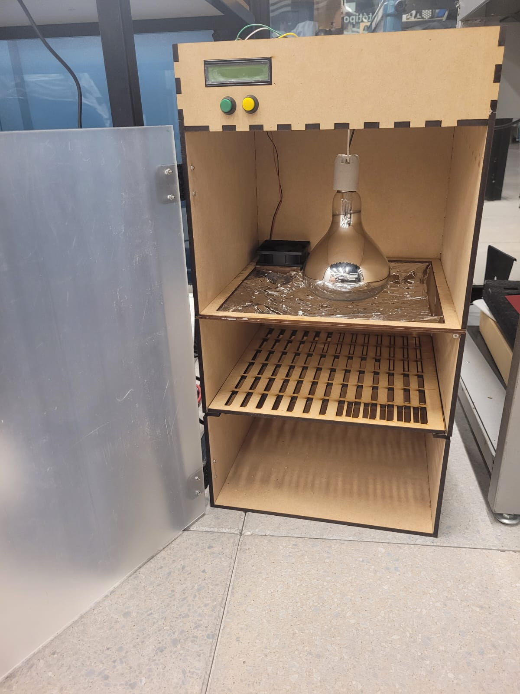
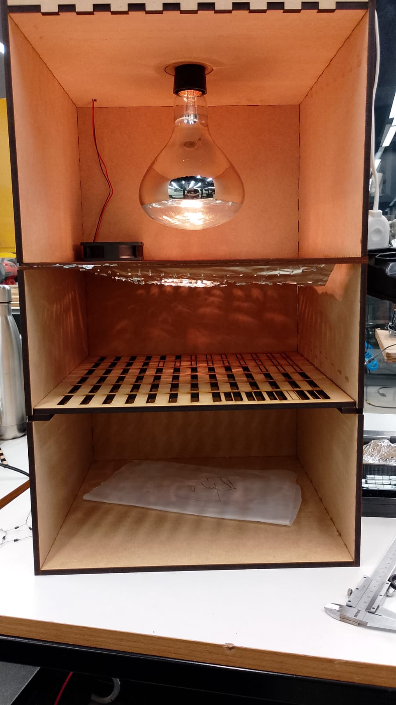

# Incubadora (também serve de estufa)

[← Todos os projetos](../README.md)

Protótipo didático em MDF e acrílico com Arduino UNO, sensor DS18B20, LCD, dois botões, lâmpada de aquecimento e ventilador. Serve como incubadora e também como estufa. O sketch liga e desliga a lâmpada por histerese e ajusta o ventilador.

> [!WARNING]
> **Não deixe o equipamento ligado sem supervisão.** Ele usa uma lâmpada de 250 W na rede elétrica, e a segurança não foi validada. Pela leitura do código:
> - o sketch trata `LOW` como lâmpada ligada, e o pino do relé começa em `LOW` ao energizar;
> - com o DS18B20 desconectado, a biblioteca retorna -127 °C, e o sketch **liga ou mantém ligada** a lâmpada;
> - não há limite máximo para a temperatura alvo nem desligamento de proteção.
>
> Os próprios comentários do código pedem para conferir a polaridade do relé no circuito real. A montagem na rede elétrica deve ser feita por pessoa habilitada.

## Sugestões de segurança (ainda não implementadas)

São recomendações para revisar antes de usar o equipamento. O firmware não as aplica, porque a polaridade do relé precisa ser confirmada no circuito real.

- Garantir que o relé fique **desligado** ao energizar e durante a reinicialização da placa, no firmware e no circuito.
- Desligar a lâmpada e sinalizar o erro quando a leitura do sensor for inválida (por exemplo, -127 °C) ou estiver fora de uma faixa plausível.
- Limitar a temperatura alvo a um mínimo e um máximo definidos em ensaio.
- Instalar uma proteção térmica **independente do Arduino** (termostato de segurança ou fusível térmico), pois um relé de estado sólido pode falhar fechado.
- Prever fusível, aterramento, isolamento das partes ligadas à rede e distância entre a lâmpada e materiais inflamáveis, como o MDF.

## Fotos

| Fechada | Aberta | Ligada |
| --- | --- | --- |
|  |  |  |

As fotos são registros do acervo, não um relatório de ensaio térmico.

## Arquivos

| Arquivo | Conteúdo |
| --- | --- |
| [Incubator_Bootcamp_V1.ino](Incubator_Bootcamp_V1/Incubator_Bootcamp_V1.ino) | Firmware 1.0.1. O comentário do código o chama de "Incubadora V03". |
| [Incubadora_V06_Organizado.svg](Incubadora_V06_Organizado.svg) | Desenho das peças da caixa. |

## Materiais registrados

- Chapas de MDF de 6 mm e de 3 mm; chapa de acrílico de 3 mm.
- Lâmpada de aquecimento de 250 W e relé de estado sólido.
- Arduino UNO, jumpers e protoboard.
- LCD 16 × 2 e trimpot de 10 kΩ.
- Sensor DS18B20 e dois botões.
- Duas dobradiças de PLA impressas em 3D e dois parafusos M2 de 12 mm.
- Folha de alumínio, ventilador de 12 V (8 × 8 cm) e extensão com tomada.
- Fonte de 7 V.

## Placa e pinos

Confirmados pelo mantenedor deste fork em 26/11/2026:

| Sinal | Pino do Arduino UNO |
| --- | --- |
| DS18B20 (dados) | 8 |
| LCD RS, EN | 12, 11 |
| LCD D4, D5, D6, D7 | 5, 4, 3, 2 |
| Relé da lâmpada | 6 |
| Ventilador (PWM) | 10 |
| Botão que diminui a temperatura alvo | 9 (`INPUT_PULLUP`) |
| Botão que aumenta a temperatura alvo | 13 (`INPUT_PULLUP`) |

A tabela não é um esquema elétrico: alimentação, acionamento do ventilador, resistores e ligação de potência não estão documentados.

## Usar na Arduino IDE

1. Abra `Incubator_Bootcamp_V1/Incubator_Bootcamp_V1.ino`.
2. Em **Ferramentas > Placa**, escolha **Arduino Uno**.
3. Pelo Gerenciador de Bibliotecas, instale `LiquidCrystal`, `OneWire` e `DallasTemperature`.
4. Use **Verificar** para compilar.
5. Antes de carregar, leia o aviso acima e confira o circuito. Faça os primeiros testes de lógica com a lâmpada desconectada da rede.
6. No Monitor Serial, use 9600 baud. A temperatura alvo inicial é 37,5 °C, com histerese de 0,5 °C. Cada ciclo com um botão pressionado muda o alvo em 0,5 °C.

**Compilação verificada em 26/11/2026** (arduino-cli, `arduino:avr` 1.8.7, LiquidCrystal 1.0.7, OneWire 2.3.8, DallasTemperature 4.0.6). Não são necessariamente as versões da montagem original. Não houve teste em placa.

## Limitações

- Os pontos de segurança do aviso acima.
- Botões sem tratamento de repique (*debounce*).
- Sem ensaio documentado de estabilidade, uniformidade ou faixa de temperatura.
- Sem esquema elétrico nem sequência de montagem.

## Próximos passos

- Registrar o esquema elétrico e o modelo do relé.
- Confirmar a polaridade do relé e então revisar o estado inicial, a falha do sensor e os limites.
- Documentar a montagem e um ensaio térmico.

## Créditos e licença

Projeto do bootcamp do [FabLab Casa Firjan](https://github.com/fablabcasafirjan/Open_Hardware). Veja [créditos](../README.md#créditos) e [licenças](../README.md#licenças).

## English summary

Educational incubator, also used as a warm lab cabinet: Arduino UNO, DS18B20, LCD, 250 W heat lamp and fan. The sketch compiles but was not tested on hardware. **Do not leave it unattended:** thermal safety is not validated, and a disconnected sensor turns the lamp on or keeps it on.
