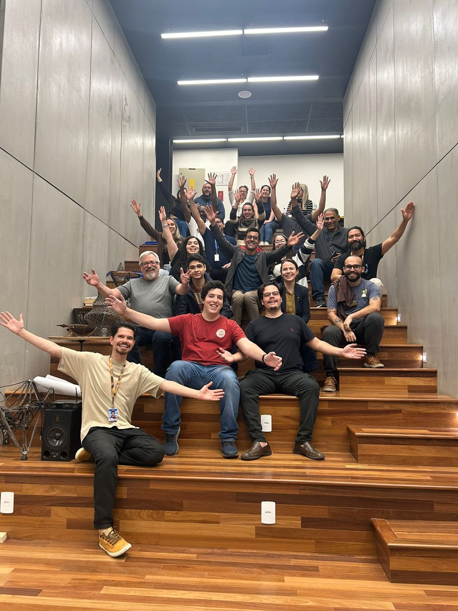
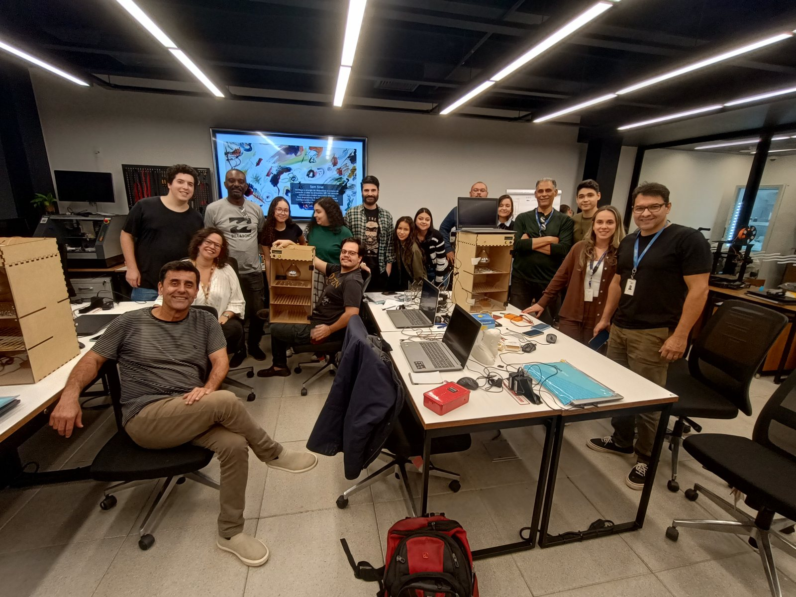
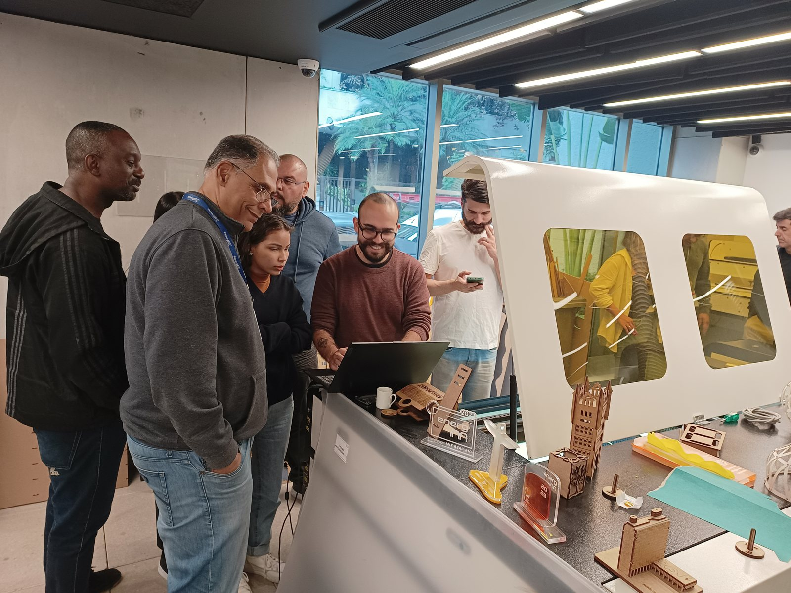
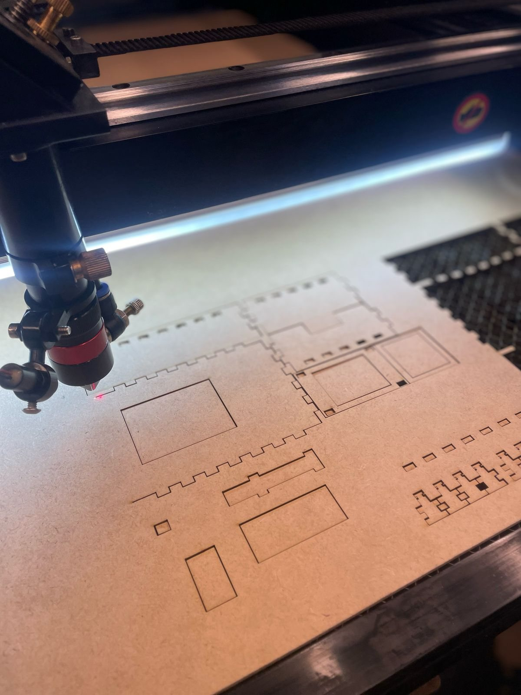
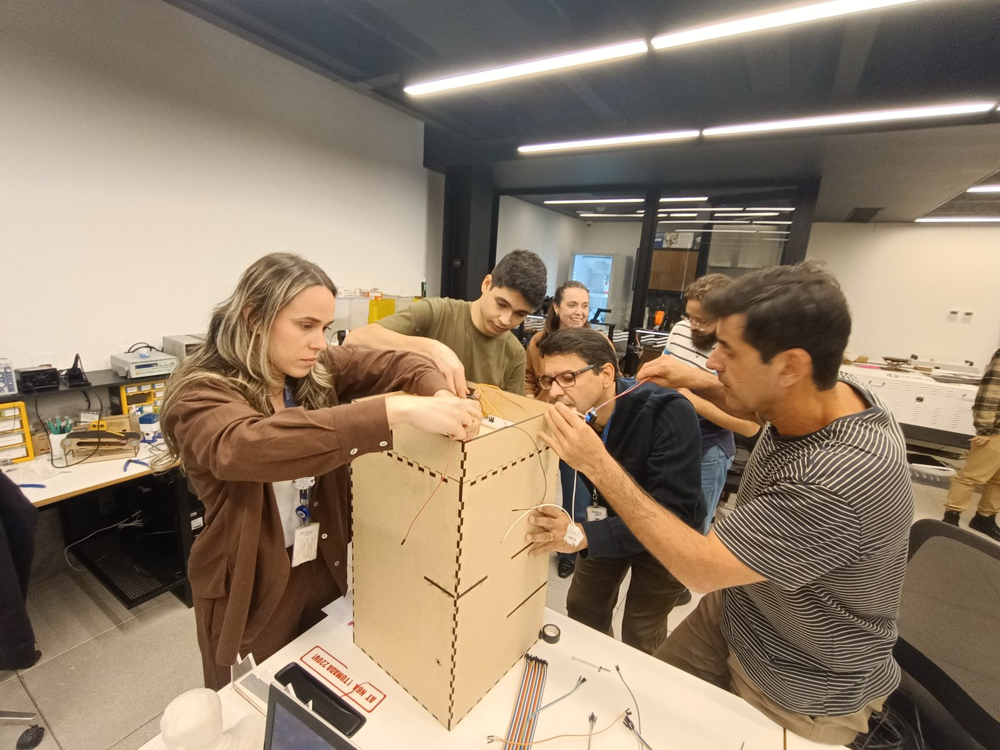
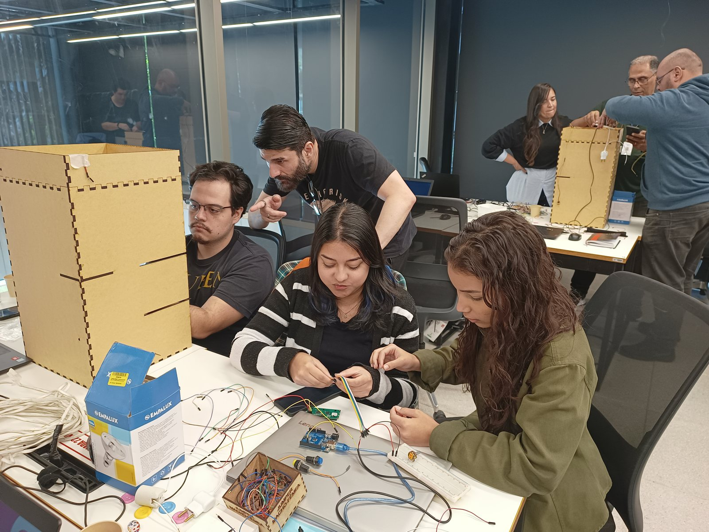
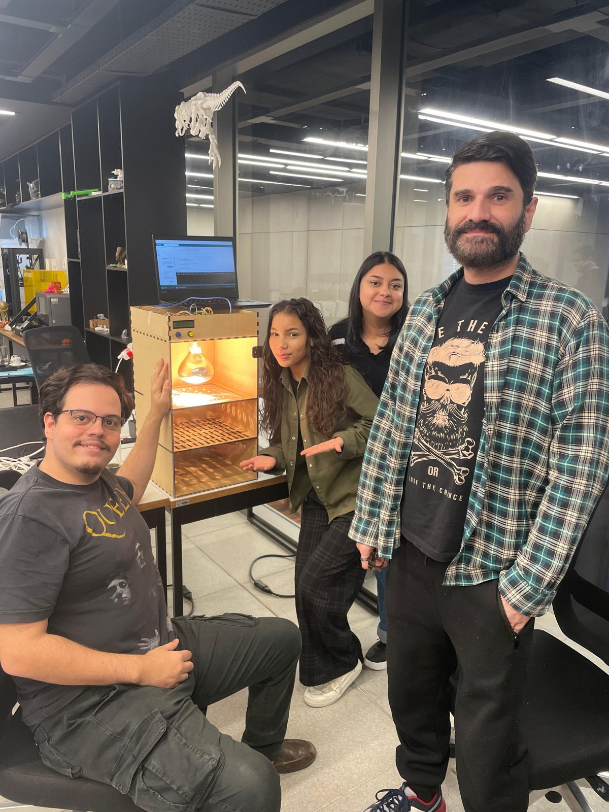
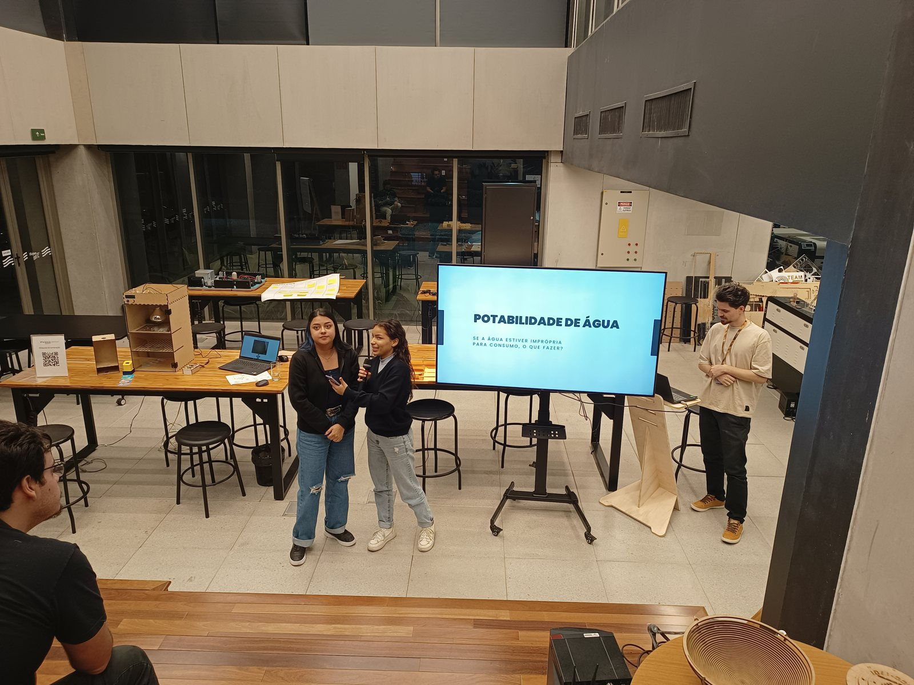

# Open Hardware

## Projetos

| | Projeto | O que há na pasta |
| --- | --- | --- |
|  | [**Incubadora/Estufa V1**](Incubator/README.md) | Sketch para Arduino UNO, desenho SVG, esquema didático, fotos e materiais. |
|  | [**Turbidímetro V1**](Turbidimeter/README.md) | Materiais, imagem PNG, fotos e histogramas. Não usa firmware. |
|  | [**Medidor de CO₂ V1**](CO2_Detector/README.md) | Sketch para ESP32 que também mede sem Wi-Fi, STL das caixas, fotos e materiais. |
|  | [**Microscópio automatizado V1**](Automated_Microscope/README.md) | Sketch para ESP32-CAM, corte a laser, imagens e materiais. |

Quatro protótipos didáticos de hardware aberto desenvolvidos no contexto do bootcamp do [FabLab Casa Firjan](https://github.com/fablabcasafirjan/Open_Hardware). A documentação está em níveis diferentes. Ter um sketch, desenho ou imagem não significa que a montagem, a medição ou o desempenho foram validados. Cada README separa o que está registrado do que falta confirmar.

## Registros do bootcamp

| Turma | Turma com as incubadoras |
| --- | --- |
|  |  |
| **Aula no corte a laser** | **Corte das peças** |
|  |  |
| **Montagem da incubadora** | **Ligação dos componentes** |
|  |  |
| **Trabalho em grupo** | **Equipe com a incubadora** |
|  |  |

**Apresentação final**



## Estrutura de pastas

```text
.
├── Incubator/              sketch, SVG, esquema didático e fotos
├── Turbidimeter/           imagem PNG, fotos e histogramas
├── CO2_Detector/           sketch, STL das caixas e fotos
├── Automated_Microscope/   sketch, SVG, imagens e fotos
├── fotos_bootcamp/         registros das atividades
├── CHANGELOG.md
└── LICENSE
```

## Como navegar e usar na Arduino IDE

1. Abra o README do projeto na tabela acima.
2. Baixe o repositório (**Code > Download ZIP**) ou clone-o.
3. Na Arduino IDE, abra o arquivo `.ino` indicado no README. Cada sketch fica em uma pasta com o mesmo nome; não junte dois sketches na mesma pasta.
4. Instale o pacote de placas e as bibliotecas listados no projeto.
5. Nos sketches com Wi-Fi, troque no `.ino` os valores `TROQUE_...` pelos seus. **Não publique nem compartilhe o sketch com os seus dados reais.**

## Versões

Os quatro projetos estão na **V1**, a versão lançada no bootcamp. As revisões de peças e desenhos usam `V0.x.0`. O firmware usa [SemVer](https://semver.org/lang/pt-BR/), indicado no topo de cada sketch e no [CHANGELOG](CHANGELOG.md). Não há tags nem releases.

| Projeto | Versão | Firmware | Revisões dos arquivos |
| --- | :---: | :---: | --- |
| Incubadora/Estufa | V1 | 1.0.1 | Desenho SVG V0.6.0; esquema didático V0.3.0 |
| Turbidímetro | V1 | — | Imagem PNG V0.1.0 |
| Medidor de CO₂ | V1 | 1.1.0 | STL V0.2.0 e V0.3.0 |
| Microscópio automatizado | V1 | 1.0.1 | Desenho SVG V0.1.0 |

## Ferramentas

| Ferramenta | Uso |
| --- | --- |
| Cortadora a laser CO₂ de 80 W (marca e modelo a confirmar) | Corte das peças em MDF e acrílico |
| Impressora 3D Bambu Lab A1 | Peças em PLA: caixa do medidor de CO₂ e dobradiças da incubadora |
| Inkscape | Desenhos SVG da incubadora e do microscópio |
| Tinkercad | Esquema didático da incubadora |
| Arduino IDE | Firmware |

## Créditos

- Repositório e projeto: **FabLab Casa Firjan** ([repositório original](https://github.com/fablabcasafirjan/Open_Hardware)).
- Planejamento dos equipamentos: **Willian Barela**, **João Victor Dutra** ([JVSDutra](https://github.com/JVSDutra)) e **Ricardo Michel**.
- Construção: **João Victor Dutra**, em consulta com Willian e Michel.
- Fotos nas pastas `fotos/` e `fotos_bootcamp/`: **Casa Firjan**.
- Medidor de CO₂: firmware de Ricardo Michel baseado em exemplo da biblioteca [S8_UART](https://github.com/jcomas/S8_UART), de **Josep Comas**; parte superior da carcaça como remix de [CO2 Weather station](https://www.thingiverse.com/thing:5382369), de **localhorst_** ([CC BY 4.0](https://creativecommons.org/licenses/by/4.0/)).
- Microscópio: firmware baseado no projeto de **Rui Santos & Sara Santos, [Random Nerd Tutorials](https://RandomNerdTutorials.com/esp32-cam-projects-ebook/)**.

## Licenças

Este fork mantém a licença do repositório original: **MIT**, no arquivo [LICENSE](LICENSE), com copyright de 2025 de `fablabcasafirjan`, sem alteração. Materiais de terceiros mantêm os próprios avisos e condições, como o remix CC BY 4.0 citado acima.

## English summary

Four educational open hardware prototypes from the FabLab Casa Firjan bootcamp: an incubator / warm cabinet ("incubadora/estufa"), a turbidimeter, a CO₂ meter that also works without Wi-Fi, and an automated microscope. Firmware is meant for the Arduino IDE. Documentation levels differ, and no build or measurement is claimed to be validated. Keep the credits and check the terms that apply to each file before reuse.

## Star History

[](https://www.star-history.com/#fablabcasafirjan/Open_Hardware&Date) 


### Replicators

First team open hardware: 

https://sirapoka.github.io

https://linsmaric.github.io

https://andregaito.github.io

https://CristianoNaveRealengo.github.io

https://yazodhara.github.io

https://Jessicarv.github.io

https://FerPrazeres.github.io

https://Leafman0.github.io

https://anaalves-lab.github.io

https://professornaveengenhao.github.io

https://millena-c.github.io

https://AliceMakers.github.io

https://JVSDutra.github.io

https://rstclair8888.github.io

https://NiltonDior.github.io

https://jbsousa1.github.io


