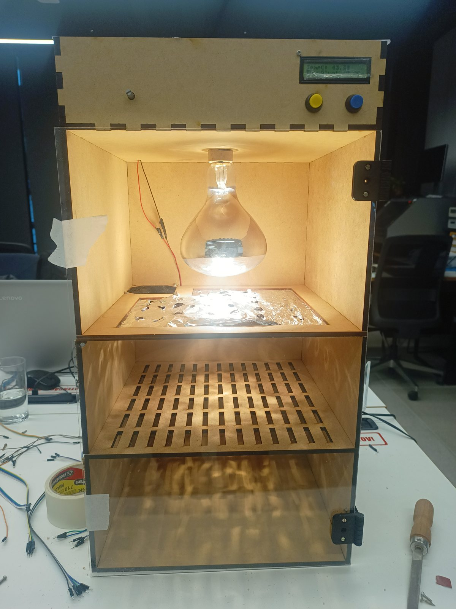
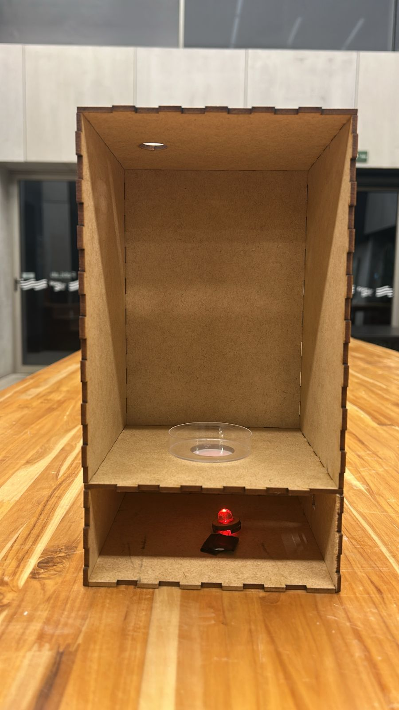
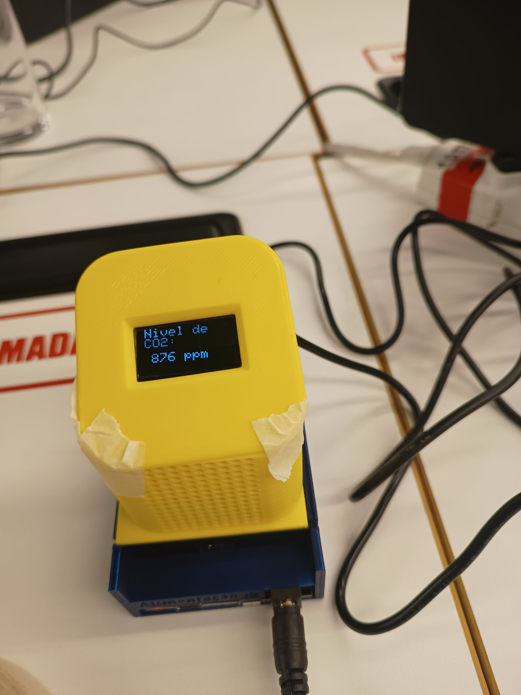
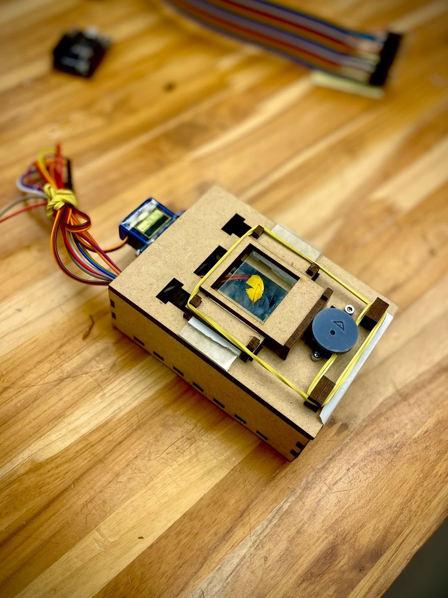
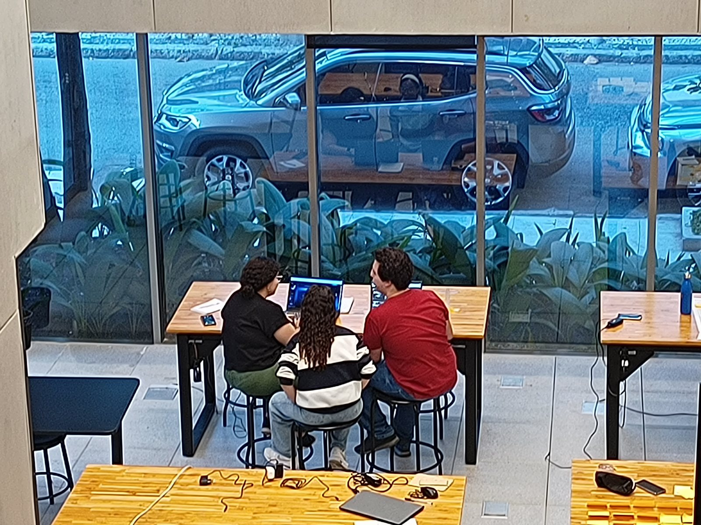

# Open Hardware

## Projetos

| | Projeto | O que há na pasta |
| --- | --- | --- |
|  | [**Incubadora** (também serve de estufa)](Incubator/README.md) | Sketch para Arduino UNO, desenho SVG, fotos e materiais. |
|  | [**Turbidímetro V1**](Turbidimeter/README.md) | Materiais, imagem PNG, fotos e histogramas. Não usa firmware. |
|  | [**Medidor de CO₂**](CO2_Detector/README.md) | Sketch para ESP32 que também mede sem Wi-Fi, STL das caixas, fotos e materiais. |
|  | [**Microscópio automatizado V1**](Automated_Microscope/README.md) | Sketch para ESP32-CAM, corte a laser, imagens e materiais. |

Quatro protótipos didáticos de hardware aberto desenvolvidos no contexto do bootcamp do [FabLab Casa Firjan](https://github.com/fablabcasafirjan/Open_Hardware). A documentação está em níveis diferentes. Ter um sketch, desenho ou imagem não significa que a montagem, a medição ou o desempenho foram validados. Cada README separa o que está registrado do que falta confirmar.

## Registros do bootcamp

| Corte a laser | Trabalho em grupo |
| --- | --- |
|  |  |

## Estrutura de pastas

```text
.
├── Incubator/              sketch, SVG e fotos
├── Turbidimeter/           imagem PNG, fotos e histogramas
├── CO2_Detector/           sketch, STL das caixas V02 e V03 e fotos
├── Automated_Microscope/   sketch, SVG, imagens e fotos
├── fotos_bootcamp/         registros das atividades
├── CHANGELOG.md
└── LICENSE
```

## Como navegar e usar na Arduino IDE

1. Abra o README do projeto na tabela acima.
2. Baixe o repositório (**Code > Download ZIP**) ou clone-o.
3. Na Arduino IDE, abra o arquivo `.ino` indicado no README. Cada sketch fica em uma pasta com o mesmo nome; não junte dois sketches na mesma pasta.
4. Instale o pacote de placas e as bibliotecas listados no projeto.
5. Nos sketches com Wi-Fi, copie `secrets.h.example` para `secrets.h`, na mesma pasta, e preencha **somente** a cópia local. O `.gitignore` impede que o Git inclua `secrets.h`; não publique nem compartilhe esse arquivo.

## Versões

Os nomes **V1, V01, V02, V03 e V06** presentes em arquivos e títulos identificam o projeto físico ou uma peça. O firmware tem numeração própria em [SemVer](https://semver.org/lang/pt-BR/), indicada no topo de cada sketch e no [CHANGELOG](CHANGELOG.md). Não há tags nem releases para essas versões.

## Créditos

- Fotos nas pastas `fotos/` e `fotos_bootcamp/`: acervo do bootcamp, de pasta compartilhada por Willian.
- Repositório de origem: [fablabcasafirjan/Open_Hardware](https://github.com/fablabcasafirjan/Open_Hardware). A autoria das contribuições está no histórico do Git de origem. Em 28/07/2025, a conta [JVSDutra](https://github.com/JVSDutra) enviou a ele sketches, desenhos, STL e imagens dos quatro projetos; o envio, por si só, não estabelece quem criou cada arquivo.
- Medidor de CO₂: sketch de Ricardo Michel, baseado em exemplo da biblioteca [S8_UART](https://github.com/jcomas/S8_UART), de Josep Comas. A parte superior da caixa é remix de [CO2 Weather station](https://www.thingiverse.com/thing:5382369), de **localhorst_** ([CC BY 4.0](https://creativecommons.org/licenses/by/4.0/)).
- Microscópio: o sketch preserva o aviso de **Rui Santos & Sara Santos, [Random Nerd Tutorials](https://RandomNerdTutorials.com/esp32-cam-projects-ebook/)**.

## Licenças

Este fork mantém a licença do repositório original: **MIT**, no arquivo [LICENSE](LICENSE), com copyright de 2025 de `fablabcasafirjan`, sem alteração. Materiais de terceiros mantêm os próprios avisos e condições, como o remix CC BY 4.0 citado acima.

## English summary

Four educational open hardware prototypes from the FabLab Casa Firjan bootcamp: an incubator (also used as a warm lab cabinet, "estufa"), a turbidimeter, a CO₂ meter that also works without Wi-Fi, and an automated microscope. Firmware is meant for the Arduino IDE. Documentation levels differ, and no build or measurement is claimed to be validated. Keep the credits and check the terms that apply to each file before reuse.

## Star History

[](https://www.star-history.com/#fablabcasafirjan/Open_Hardware&Date) 


### Replicators

First team open hardware: 

https://sirapoka.github.io

https://linsmaric.github.io

https://andregaito.github.io

https://CristianoNaveRealengo.github.io

https://yazodhara.github.io

https://Jessicarv.github.io

https://FerPrazeres.github.io

https://Leafman0.github.io

https://anaalves-lab.github.io

https://professornaveengenhao.github.io

https://millena-c.github.io

https://AliceMakers.github.io

https://JVSDutra.github.io

https://rstclair8888.github.io

https://NiltonDior.github.io

https://jbsousa1.github.io


