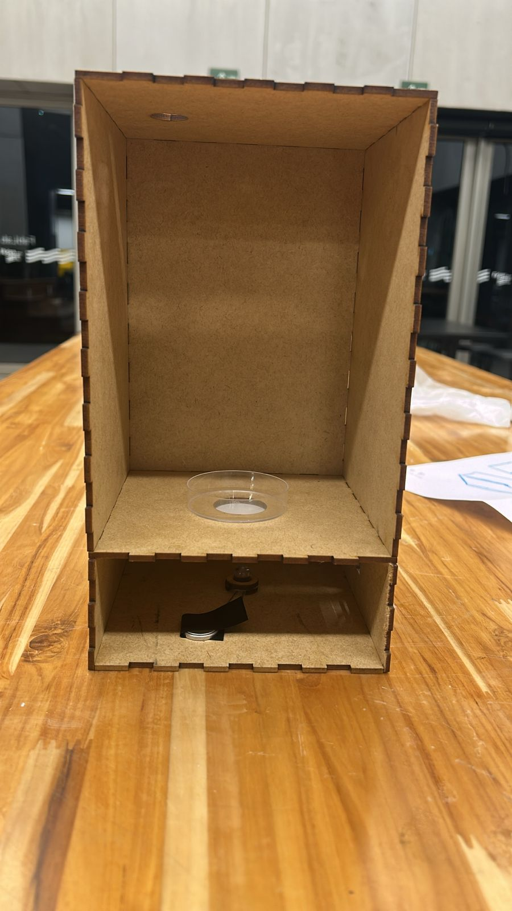
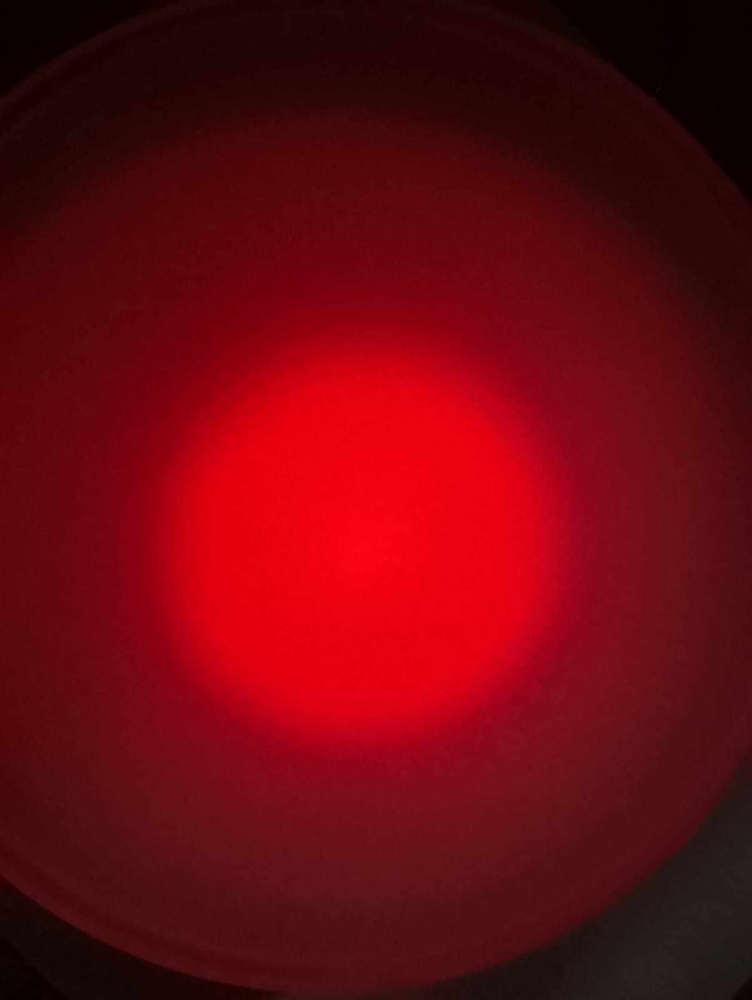

# Turbidímetro V1

[← Todos os projetos](../README.md)

Protótipo didático em MDF para observar como amostras alteram a luz de um LED vista por uma câmera. Não usa microcontrolador nem firmware.

## Fotos

| LED desligado | LED ligado | Vista pela câmera |
| --- | --- | --- |
|  |  |  |

## Observações registradas

Captura de tela com histogramas de intensidade. O nome do arquivo indica um ensaio com água leitosa em placa de Petri. As condições de aquisição, as concentrações e o método de análise não estão documentados. **Não é uma curva de calibração** e não há valores em NTU.

## Arquivos

- [Turbd_V1.png](Turbd_V1.png): imagem de 15118 × 15118 pixels com traços muito claros e algumas marcas vermelhas; parece um desenho de peças, **a confirmar**. Por ser muito grande, não é exibida aqui.

## Materiais registrados

- Chapa de MDF de 3 mm.
- Um LED de 10 mm.
- Uma bateria CR2032 de 3 V.
- Folha A4 ou outro material difusor.
- Câmera de celular, webcam ou equivalente.

Sugestão registrada no projeto de origem: no lugar do copo plástico, usar um béquer ou um copo de paredes retas.

## Ligações e uso

A eletrônica é apenas o LED com a bateria CR2032 (confirmado pelo mantenedor deste fork em 26/11/2026). Não há nada para abrir na Arduino IDE.

## Limitações

- Sem sequência de montagem, geometria ou posição da câmera documentadas.
- Sem procedimento de medição, calibração ou dados de repetibilidade.

## Próximos passos

- Confirmar o conteúdo de `Turbd_V1.png` e publicar o desenho de corte, se existir.
- Documentar montagem, aquisição de imagens, preparo das amostras e análise.
- Calibrar com padrões antes de apresentar resultados quantitativos.

## Créditos e licença

Projeto do bootcamp do [FabLab Casa Firjan](https://github.com/fablabcasafirjan/Open_Hardware). Veja [créditos](../README.md#créditos) e [licenças](../README.md#licenças).

## English summary

Educational turbidimeter made of an MDF enclosure, one LED powered by a CR2032 cell, a diffuser and a camera. No firmware. The histogram screenshot is an uncalibrated observation, not NTU data.
