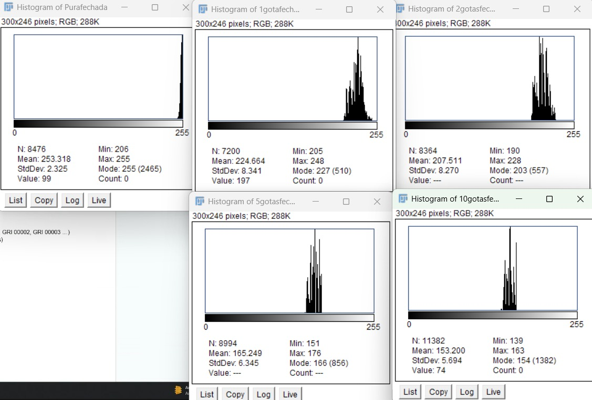
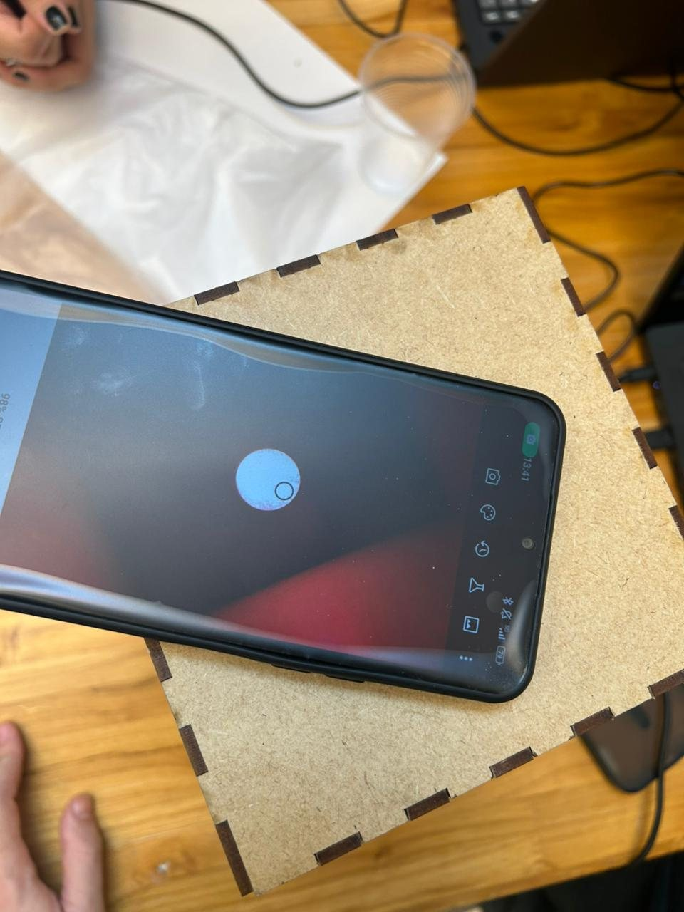

# Turbidímetro V1

**Câmara em MDF com LED para observar amostras pela câmera de um celular**

Protótipo com o LED ligado.

[← Todos os projetos](../README.md)

---

## 📖 Visão geral

Um LED ilumina por baixo um recipiente com a amostra, dentro de uma caixa de MDF. Uma câmera registra como a luz atravessa a amostra. Não há microcontrolador.

### 🧪 Como medir

1. Fixe o **foco** e o **brilho** da câmera.
2. Apoie a câmera em cima do turbidímetro, apontada para baixo pelo furo da tampa.
3. Com o LED ligado, coloque a amostra sobre o furo iluminado.
4. Fotografe. Troque a amostra e repita, sem mudar a posição nem os ajustes da câmera.
5. Em cada foto, meça o **brilho** e a **saturação** dos pixels que mostram a amostra, na área por onde a luz passou.

Cada participante montou o próprio turbidímetro, com variações, como parte da experimentação.

### 📊 Observações registradas

Captura de tela com histogramas de intensidade de pixels. O nome do arquivo indica um ensaio com água leitosa em placa de Petri. As condições de aquisição, as concentrações e o método de análise não estão documentados. **Não é uma curva de calibração** e não há valores em NTU.

### ⚠️ Limitações conhecidas

- Sem calibração, valores em NTU ou dados de repetibilidade.

---

## 🛠️ Ferramentas e processos

| Etapa | Ferramenta |
| --- | --- |
| Corte do MDF | Cortadora a laser CO₂ de 80 W (marca e modelo a confirmar) |
| Registro | Câmera de celular, webcam ou equivalente, com foco e brilho fixos |
| Análise | Brilho e saturação dos pixels da amostra |

---

## 🧾 Lista de materiais

| Item | Qtd. | Especificação |
| --- | :---: | --- |
| Chapa de MDF | 1 | 3 mm |
| LED | 1 | 10 mm (vermelho nas fotos) |
| Bateria | 1 | CR2032, 3 V |
| Material difusor | 1 | Folha A4 ou equivalente |
| Câmera | 1 | Celular, webcam ou equivalente |
| Recipiente de amostra | — | Copo plástico ou placa de Petri |

Sugestão registrada no projeto de origem: no lugar do copo plástico, usar um béquer ou um copo de paredes retas.

---

## 🔧 Hardware

A eletrônica é apenas o LED com a bateria CR2032 (confirmado pelo mantenedor deste fork em 26/11/2026).

## 💻 Firmware

Não usa firmware. Não há nada para abrir na Arduino IDE.

---

## 🚦 Status

| Verificação | Situação |
| --- | --- |
| Calibração e valores em NTU | **Não há** |
| Repetibilidade | **Não avaliada** |

**Próximos passos:** repetir medições da mesma amostra e calibrar com padrões antes de apresentar resultados quantitativos.

---

## 📷 Fotos

| Peças | Câmara de amostra | Celular sobre a caixa |
| --- | --- | --- |
|  |  |  |

| LED desligado | LED ligado | Vista pela câmera |
| --- | --- | --- |
|  |  |  |

## 🗂️ Arquivos

- [Turbd_V0.1.0.png](Turbd_V0.1.0.png): imagem de 15118 × 15118 pixels com traços muito claros e algumas marcas vermelhas; parece um desenho de peças, **a confirmar**. Por ser muito grande, não é exibida aqui.

## 👥 Créditos

- Projeto do bootcamp do [FabLab Casa Firjan](https://github.com/fablabcasafirjan/Open_Hardware).
- Planejamento dos equipamentos: **Willian Barela**, **João Victor Dutra** ([JVSDutra](https://github.com/JVSDutra)) e **Ricardo Michel**.
- Construção: **João Victor Dutra**, em consulta com Willian e Michel.
- Fotos em `fotos/`: **Casa Firjan**.

## 📄 Licença

MIT, a mesma do repositório original ([LICENSE](../LICENSE)). Veja [créditos](../README.md#créditos) e [licenças](../README.md#licenças).

## English summary

Educational turbidimeter made of an MDF enclosure, one LED powered by a CR2032 cell, a diffuser and a camera. No firmware. The histogram screenshot is an uncalibrated observation, not NTU data.
