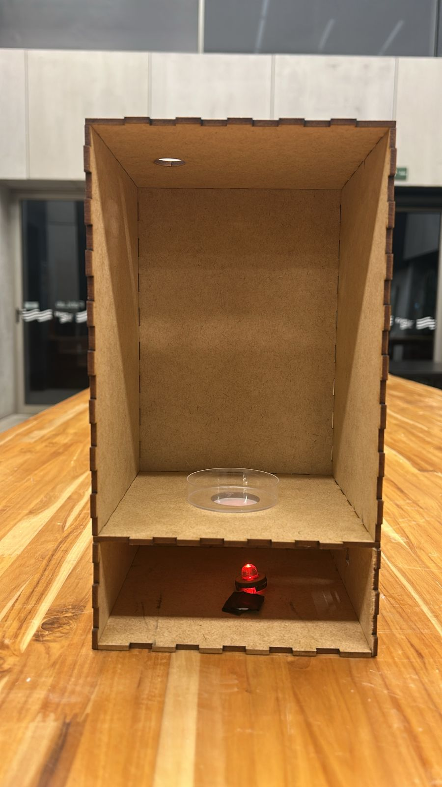
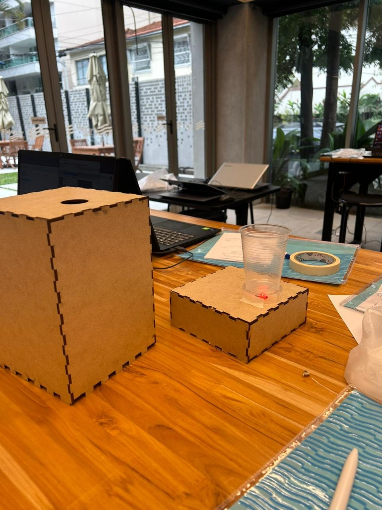
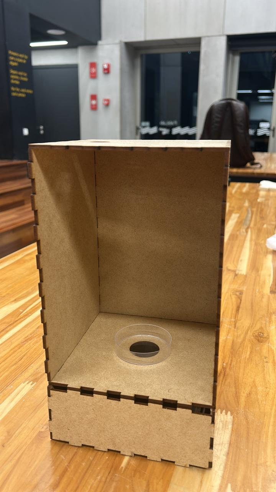

# Turbidímetro V1

**Câmara em MDF com LED para observar amostras pela câmera de um celular**

Protótipo com o LED ligado.

[← Todos os projetos](../README.md)

---

## 📖 Visão geral

Um LED ilumina por baixo um recipiente com a amostra, dentro de uma caixa de MDF. Uma câmera registra como a luz atravessa a amostra. Não há microcontrolador.

### 🧪 Como é usado

1. A amostra fica no recipiente, sobre a abertura iluminada pelo LED.
2. A câmera do celular, ou outra câmera, registra a imagem.
3. As imagens de amostras diferentes podem ser comparadas.

Esta é uma descrição geral. Geometria, posição da câmera, preparo das amostras e análise não estão padronizados.

### 📊 Observações registradas

Captura de tela com histogramas de intensidade de pixels. O nome do arquivo indica um ensaio com água leitosa em placa de Petri. As condições de aquisição, as concentrações e o método de análise não estão documentados. **Não é uma curva de calibração** e não há valores em NTU.

### ⚠️ Limitações conhecidas

- Sem sequência de montagem, geometria ou posição da câmera documentadas.
- Sem procedimento de medição, calibração ou dados de repetibilidade.
- Ajustes automáticos de câmeras de celular podem alterar as imagens e não foram tratados.

---

## 🛠️ Ferramentas e processos

| Etapa | Ferramenta | Observação |
| --- | --- | --- |
| Caixa | Peças de MDF encaixadas | Processo e parâmetros de corte **a confirmar** |
| Registro | Câmera de celular, webcam ou equivalente | Lista original |
| Análise | **A confirmar** | A captura de tela mostra janelas de histograma |

---

## 🧾 Lista de materiais

| Item | Qtd. | Especificação | Origem da informação |
| --- | :---: | --- | --- |
| Chapa de MDF | 1 | 3 mm | Lista original |
| LED | 1 | 10 mm (vermelho nas fotos) | Lista original e fotos |
| Bateria | 1 | CR2032, 3 V | Lista original |
| Material difusor | 1 | Folha A4 ou equivalente | Lista original |
| Câmera | 1 | Celular, webcam ou equivalente | Lista original |
| Recipiente de amostra | — | Copo plástico ou placa; modelo não registrado | Fotos e nome do arquivo de resultados, **a confirmar** |

Sugestão registrada no projeto de origem: no lugar do copo plástico, usar um béquer ou um copo de paredes retas.

---

## 🔧 Hardware

A eletrônica é apenas o LED com a bateria CR2032 (confirmado pelo mantenedor deste fork em 26/11/2026).

## 💻 Firmware

Não usa firmware. Não há nada para abrir na Arduino IDE.

---

## 🧰 Como reproduzir

Não há procedimento completo. O acervo permite ver a construção geral nas fotos e consultar a lista de materiais. Antes de reproduzir medições, é preciso definir e documentar geometria, aquisição, amostras e calibração.

## 🚦 Status

| Verificação | Situação |
| --- | --- |
| Montagem documentada passo a passo | **Não** |
| Calibração e valores em NTU | **Não há** |
| Repetibilidade | **Não avaliada** |

**Próximos passos:** confirmar o conteúdo de `Turbd_V1.png` e publicar o desenho de corte, se existir; documentar montagem e medição; calibrar com padrões antes de apresentar resultados quantitativos.

---

## 📷 Fotos

| Peças | Câmara de amostra | Celular sobre a caixa |
| --- | --- | --- |
|  |  |  |

| LED desligado | LED ligado | Vista pela câmera |
| --- | --- | --- |
|  |  |  |

## 🗂️ Arquivos

- [Turbd_V1.png](Turbd_V1.png): imagem de 15118 × 15118 pixels com traços muito claros e algumas marcas vermelhas; parece um desenho de peças, **a confirmar**. Por ser muito grande, não é exibida aqui.

## 👥 Créditos

Projeto do bootcamp do [FabLab Casa Firjan](https://github.com/fablabcasafirjan/Open_Hardware). Fotos em `fotos/`: acervo do bootcamp, de pasta compartilhada por Willian.

## 📄 Licença

MIT, a mesma do repositório original ([LICENSE](../LICENSE)). Veja [créditos](../README.md#créditos) e [licenças](../README.md#licenças).

## English summary

Educational turbidimeter made of an MDF enclosure, one LED powered by a CR2032 cell, a diffuser and a camera. No firmware. The histogram screenshot is an uncalibrated observation, not NTU data.
